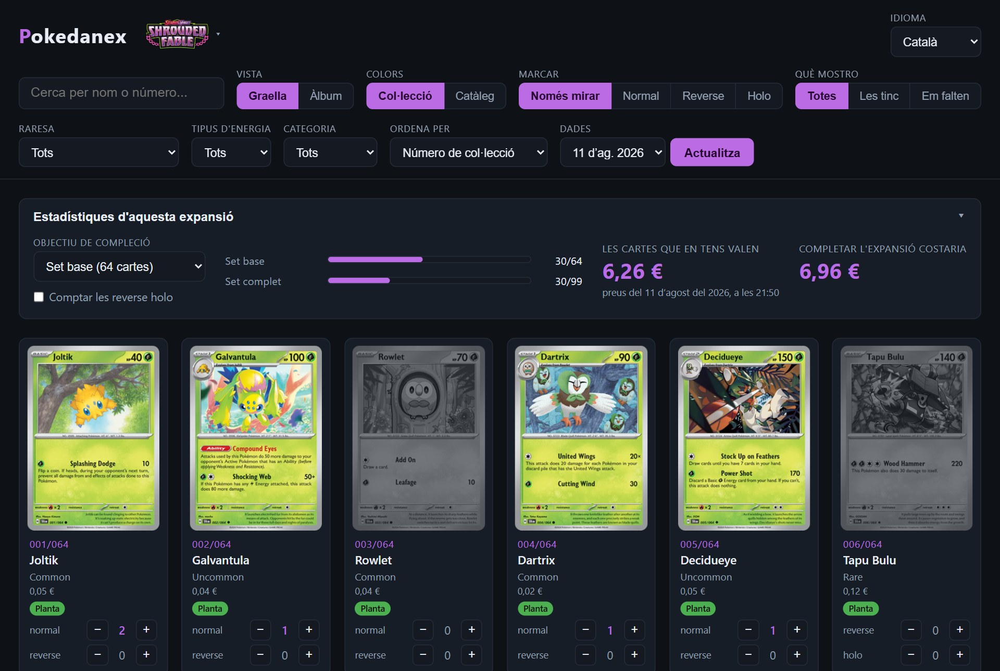
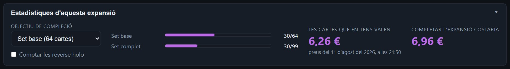
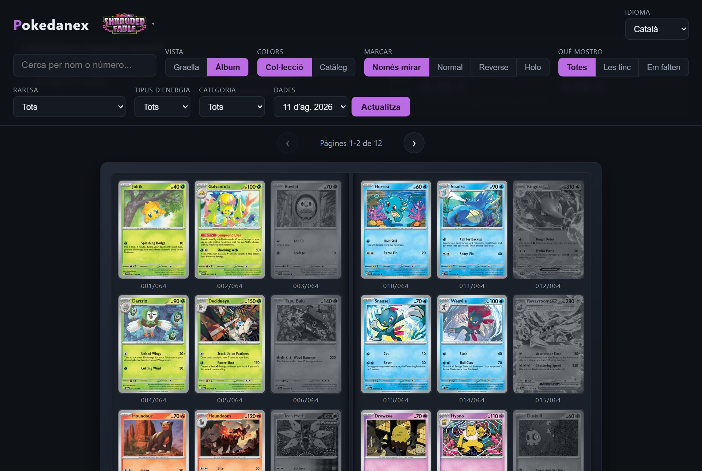
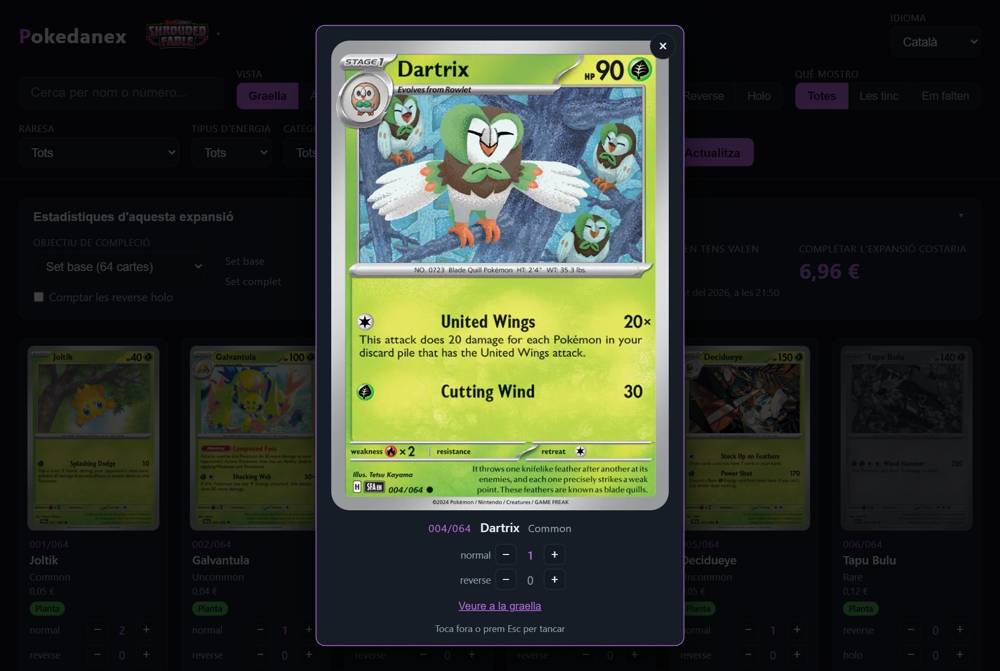
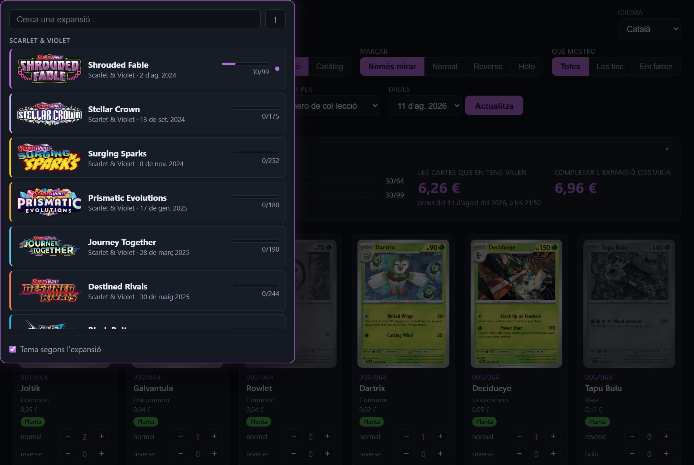
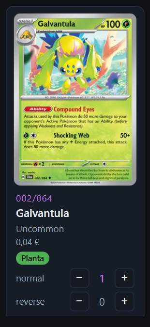
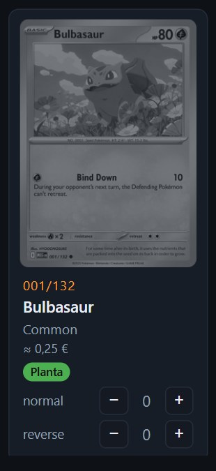
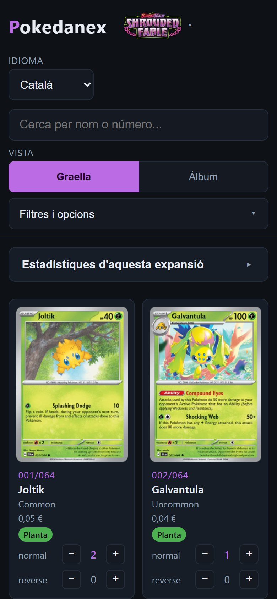
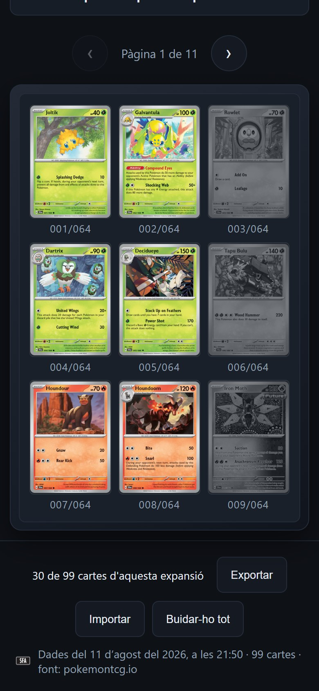

# Part III — El producte: la web Pokedanex

> ⚠️ **Nota de treball, per esborrar abans del lliurament.** Esborrany. Les
> captures surten de `tools/captures_part3.mjs` i l'estudi de quines s'han
> triat és a `docs/estudi-captures-part3.md`. Les xifres de codi són les del
> 10 de novembre del 2026 i s'hauran de tornar a comptar al final.

---

## 16. Què havia de fer

L'encàrrec inicial es pot dir en una frase: una web on un col·leccionista
de cartes Pokémon marca quines cartes té, i la web li diu **quant val el
que té i quant li costaria aconseguir el que li falta**.

Abans de generar cap línia de codi es va fer una entrevista de preguntes i
respostes per concretar aquesta frase. En va sortir un document
d'especificacions, que és la llista del que la web havia de fer i, igual
d'important, del que no havia de fer encara. La primera versió es va
limitar expressament:

- **Una sola expansió.** Una expansió és una tanda de cartes que es
  publica junta. Es va triar Shrouded Fable, que té 99 cartes: 64 de
  numerades i 35 de secretes, més difícils de trobar.
- **Sense comptes d'usuari.** No cal registrar-se ni posar cap
  contrasenya. La col·lecció es desa al navegador de cada persona.
- **Pensada per a ordinador**, i el mòbil per a més endavant.
- **En tres idiomes:** català, castellà i anglès.

Dues coses van quedar fora i encara hi són: el registre d'usuaris i un
càlcul que busqui a quines botigues surt més barat comprar les cartes que
falten. El cost que dona la web és una suma senzilla dels preus, sense
despeses d'enviament ni ofertes.

La resta de la llista inicial sí que ha crescut. Avui la web té 14
expansions, s'ha adaptat al mòbil i és publicada a internet. Els capítols
següents expliquen com.

## 17. Com està feta per dins

Pokedanex és el que s'anomena una **web estàtica**. Vol dir que no hi ha
cap programa funcionant en un altre ordinador ni cap base de dades: la web
són fitxers, i el navegador de qui la visita els llegeix i ho fa tot. És la
manera més senzilla i més barata de fer una web, i per a aquest projecte
n'hi ha prou.

Aquests fitxers s'organitzen en tres peces:

| Peça | Què hi ha | Per a què serveix |
|---|---|---|
| **Les dades** | De cada carta: nom, número, raresa, imatge i preus | És el que la web sap de les cartes |
| **Els textos** | Cada frase de la pantalla, escrita en tres idiomes | Permet canviar d'idioma a l'instant |
| **La pantalla** | El que es veu i el que passa quan es clica | Ensenya les cartes, compta i calcula |

*Taula 1. Les tres peces de la web.*

Separar-ho així té un avantatge pràctic: per afegir una expansió n'hi ha
prou d'afegir-ne les dades i triar-li un color, i per corregir una
traducció només cal tocar els textos. La resta no s'ha de tocar.

La col·lecció de cada persona no és en cap d'aquestes tres peces. Es desa
al seu navegador, en un espai que els navegadors reserven a cada web. Això
explica per què no fan falta comptes d'usuari, i també té un límit que cal
dir: la col·lecció es queda en aquell navegador i en aquell aparell. Per
portar-la a un altre, la web permet exportar-la a un fitxer i importar-la
després.

En total, el 10 de novembre del 2026 la web eren 14 fitxers i unes 6.000
línies de codi. L'autora no n'ha escrit cap: totes les ha generat la
intel·ligència artificial.

## 18. Les funcionalitats, una per una

**La graella.** És la pantalla principal (figura 1). Cada carta té la
seva fitxa amb la imatge, el número, el nom, la raresa, el preu i uns
comptadors per dir quantes còpies se'n tenen. Hi ha un comptador per
variant, perquè una mateixa carta pot existir en versió normal i en
versions brillants (*reverse* i *holo*), que poden tenir preus diferents. Les
cartes que falten es veuen en gris, i així d'un cop d'ull se sap què es té
i què no.

*Figura 1. La graella amb el panell d'estadístiques a dalt. La col·lecció
que es veu en totes les figures és un exemple fet per a les captures, amb
30 cartes de 99.*

A dalt hi ha els controls. Es pot buscar una carta pel nom o pel número,
filtrar per raresa, tipus d'energia o categoria, veure només les que es
tenen o només les que falten, i canviar l'ordre. El control «Marcar»
serveix per anar de pressa: un cop triada una variant, cada clic sobre una
carta n'afegeix una còpia, sense haver de buscar el botó «+». El control
«Colors» permet veure totes les cartes en color, com en un catàleg, encara
que no es tinguin.

**Les estadístiques.** És la part que respon a l'encàrrec (figura 2). La
web suma el preu de les cartes marcades i diu quant valen; suma el de les
que falten i diu quant costaria completar l'expansió. Es pot triar
l'objectiu: només les 64 cartes numerades o totes 99. Sota les xifres
sempre hi ha la data dels preus, perquè un preu sense data no diu gaire.

*Figura 2. El panell d'estadístiques. Amb l'objectiu de les 64 cartes
numerades, la col·lecció d'exemple val 6,26 € i completar-la costaria
6,96 €, amb preus de l'11 d'agost del 2026.*

**L'àlbum.** Els col·leccionistes guarden les cartes en arxivadors amb
fulls de nou butxaques. La vista d'àlbum (figura 3) ensenya les cartes
igual: nou per pàgina, de tres en tres, amb dues pàgines de costat com un
arxivador obert, i unes fletxes per passar full. Serveix per comparar la
pantalla amb l'àlbum de debò que es té a les mans.

*Figura 3. La vista d'àlbum. Les cartes en gris són les que falten.*

**El zoom i el selector d'expansions.** Quan no s'està marcant, clicar una
carta l'obre ampliada, per mirar-ne el dibuix i llegir-ne el text (figura
4). I clicant el
logotip de dalt s'obre la llista de les 14 expansions, cadascuna amb la
data en què va sortir i les cartes que se'n tenen (figura 5). En canviar
d'expansió, la web canvia també de color: cada una té el seu.

| Figura 4. Una carta ampliada | Figura 5. El selector d'expansions |
|---|---|
|  |  |

## 19. D'on surten les dades i els preus

La web no s'inventa res: les cartes, les imatges i els preus venen de
**pokemontcg.io**, un servei gratuït d'internet que dona aquestes dades a
qui les demana. Els preus que porta són els de Cardmarket, el mercat
europeu de cartes, en euros. La web els fa servir suposant cartes en
anglès i en bon estat.

Des del principi es va veure que aquest servei fallava de tant en tant.
Per això es va decidir que la web no en dependria per funcionar. No li
demana les dades cada vegada que algú la visita: treballa amb una **còpia
desada**, que porta la data del dia que es va fer. Només li torna a
demanar dades quan algú prem el botó «Actualitza», i llavors es crea una
còpia nova sense esborrar les anteriors. Si el servei cau, la web continua funcionant amb l'última
còpia, i a més es poden tornar a consultar els preus d'un altre dia.

El problema més difícil va arribar amb les expansions noves. La web deia
que completar-ne una costava 0,00 €. El càlcul era correcte: el servei no
tenia cap preu de Cardmarket per a aquelles cartes, i la suma de cap preu
és zero. Però un zero així enganya, perquè qui el llegeix entén que les
cartes són gratuïtes.

La solució va ser una regla en tres passos:

1. Si hi ha preu de Cardmarket, es fa servir aquest.
2. Si no n'hi ha, es fa servir el de TCGplayer, el mercat nord-americà,
   passat de dòlars a euros amb un canvi fix (un dòlar, 0,90 euros). Com
   que és una aproximació, la web el marca amb el signe «≈» (figura 6).
3. Si cap dels dos mercats té preu, la web hi posa un guió i compta a
   part quantes cartes s'han quedat sense preu.

| Preu de Cardmarket | Preu aproximat |
|---|---|
|  |  |

*Figura 6. Dues fitxes de carta. A l'esquerra, una carta de Shrouded Fable
amb preu de Cardmarket. A la dreta, una de l'expansió Mega Evolution, amb
el preu convertit i marcat amb «≈».*

La idea de fons val per a qualsevol web que treballi amb dades d'altri:
quan falta una dada, és millor una aproximació que avisa que ho és, o un
buit que es veu, que no pas un número que sembla exacte i no ho és.

## 20. Ordinador i mòbil: la mateixa web en dues pantalles

La web es va pensar per a ordinador, i en un mòbil no n'hi ha prou de
fer-ho tot més petit. Canvien tres coses. La pantalla és estreta. No hi ha
ratolí, i per tant no hi ha clic dret ni es pot passar per sobre d'un botó
per veure'n l'explicació. I el dit és molt menys precís que la fletxa del ratolí.

L'adaptació es va fer l'11 d'agost del 2026 en tres rondes de revisió,
totes fetes per la intel·ligència artificial, que van trobar i arreglar 89
problemes. Els canvis més visibles (figura 7) són aquests:

- Els controls, que a l'ordinador ocupen dues fileres, queden recollits
  darrere d'un sol botó, «Filtres i opcions».
- L'àlbum ensenya una pàgina en lloc de dues.
- Els botons es fan més grans, fins als 44 píxels que es recomanen perquè
  un dit els encerti.
- El que a l'ordinador es fa amb el clic dret o amb el teclat té un botó
  propi o un gest: per exemple, mantenir el dit sobre una carta l'amplia.

| Figura 7a. La graella en un mòbil | Figura 7b. L'àlbum en un mòbil |
|---|---|
|  |  |

*Figura 7. La web en una pantalla de mòbil. Les captures estan fetes amb
una pantalla simulada de 390 píxels d'amplada, no amb un telèfon.*

Aquell mateix dia es va treballar l'**accessibilitat**, que vol dir que la
web la pugui fer servir tothom, també qui hi veu malament. Cada expansió
té el seu color, i un color bonic pot ser impossible de llegir. Les normes
internacionals d'accessibilitat (WCAG) ho mesuren amb un número, el
contrast entre el text i el fons, que ha de ser com a mínim de 4,5 a 1.
Els colors no es van triar a ull: els de 13 de les 14 expansions es van
ajustar per càlcul, i van quedar amb contrastos d'entre 6,2 i 12,5 a 1,
força per sobre del mínim. A més, la web redueix les animacions a qui ha
demanat al seu aparell que ho faci.

Que tot això funcioni per a persones de debò, amb telèfons de debò, no ho
pot dir aquest capítol: ho han de dir les proves amb usuaris de la Part
IV.

## 21. Publicar-la a internet

Mentre es fa, una web només es veu a l'ordinador on s'està fent. Perquè la
pugui obrir tothom, els fitxers han d'estar en un ordinador connectat
sempre a internet. D'aquest servei se'n diu allotjament, o *hosting*, i
sovint es paga.

Aquí es va fer servir **GitHub Pages**. GitHub és el servei on ja es
desava el codi del projecte, i ofereix allotjament gratuït amb una
condició: que el codi sigui públic, a la vista de tothom. Abans d'acceptar
es va comprovar que no s'hi hagués desat mai cap contrasenya ni cap clau.
Que el codi sigui públic, a més, va bé al treball: qui el vulgui revisar,
pot fer-ho. Es van mirar dues alternatives, Netlify i Cloudflare Pages, i
es van descartar perquè obligaven a obrir un compte en un altre servei
sense donar res a canvi.

La web és pública des del 10 d'agost del 2026 en aquesta adreça:

**https://gerardrevesv.github.io/pokedanex/**

La publicació és automàtica. Cada vegada que un canvi s'aprova i s'afegeix
a la versió principal del codi, la web es torna a publicar sola: el primer
cop que es va comprovar, el canvi era visible al cap d'un minut. Ningú no
ha de copiar fitxers a mà.

El cost de l'allotjament és de **0 €**. Tampoc no costen res les dades ni
les eines de publicació. L'única despesa del projecte és la subscripció de
l'eina d'intel·ligència artificial.
