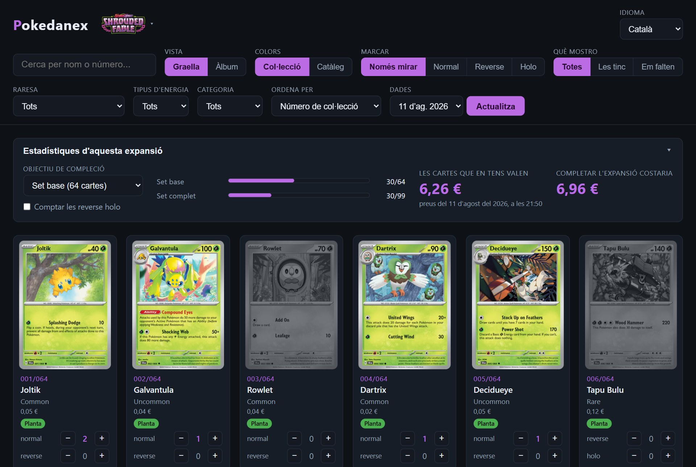
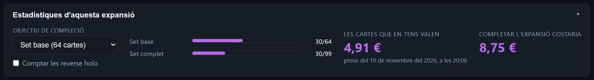
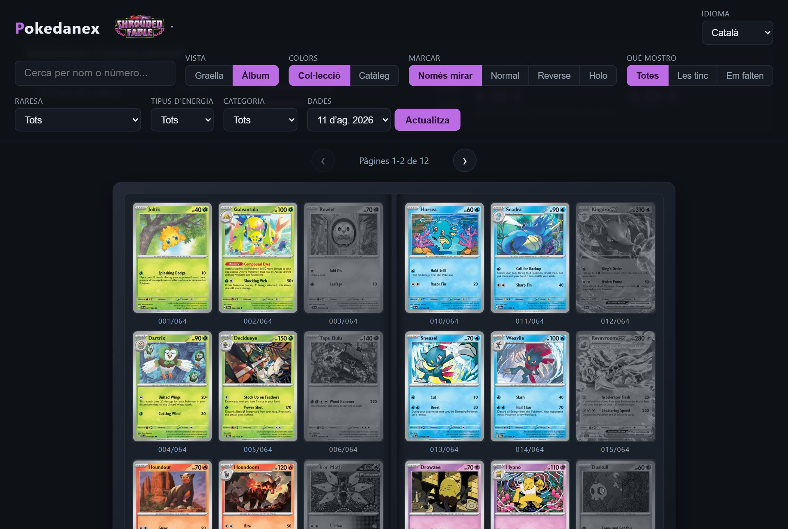
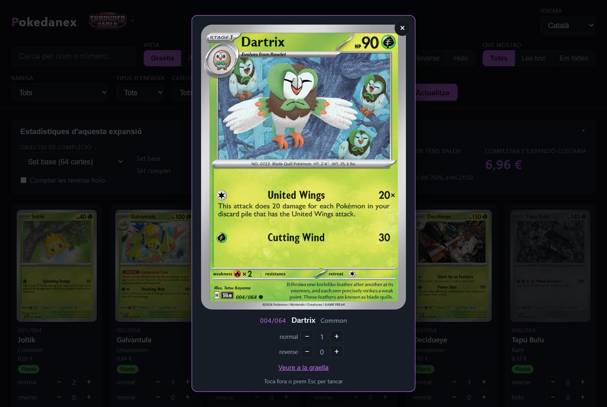
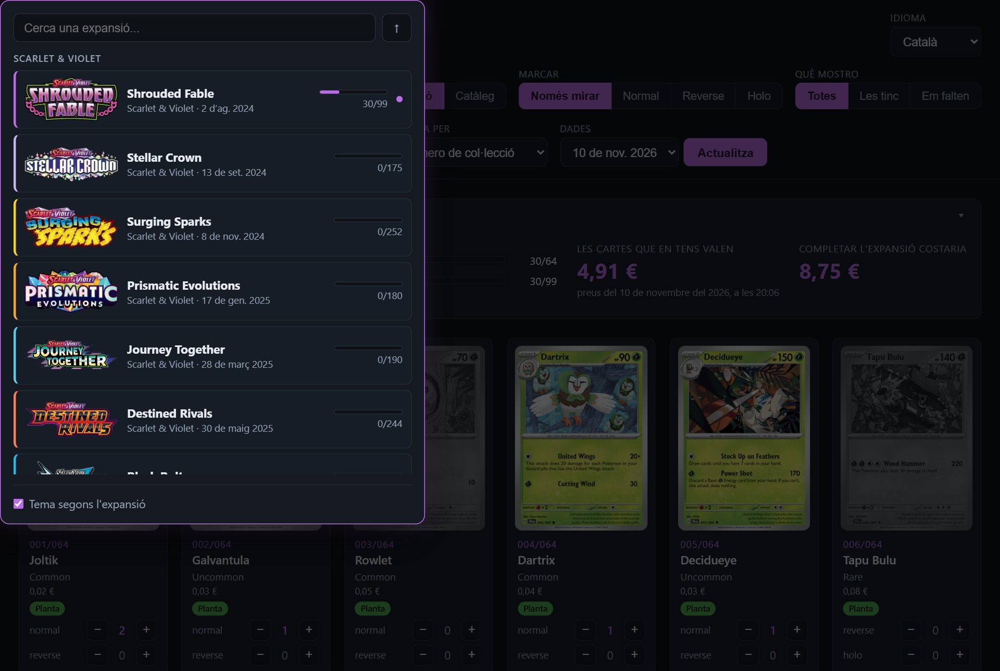
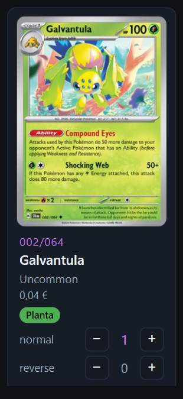
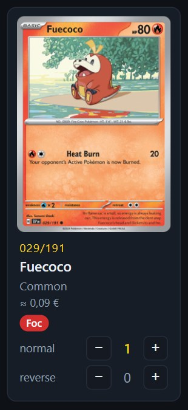
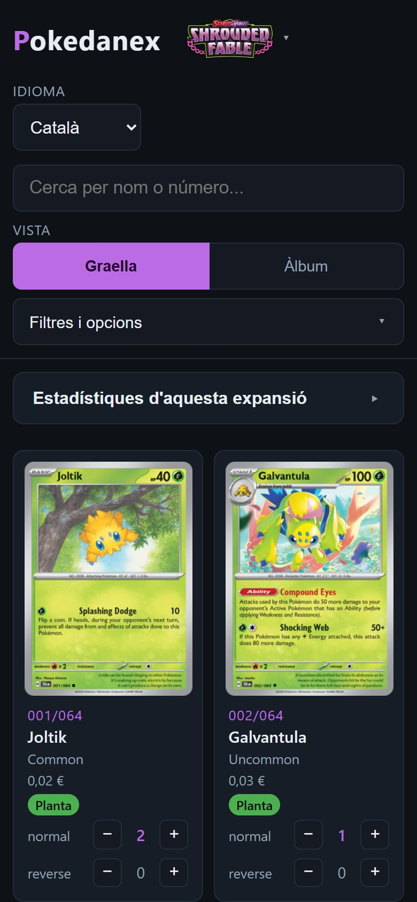
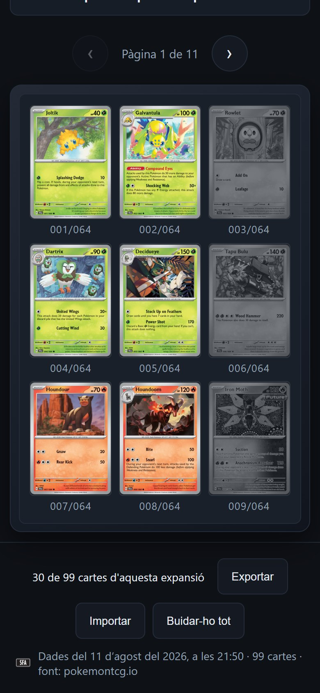

# Pokedanex: tot el treball en un sol document

> **Còpia per revisar.** Aquest fitxer es genera sol a partir dels textos de `treball/`. No s'ha de corregir aquí: els canvis es fan als textos d'origen i es torna a generar.

## Guia d'aquesta entrega

Aquest document recull el que hi ha escrit del treball de recerca fins a
l'11 de novembre del 2026. És una entrega parcial: tot el que hi ha és en
esborrany i encara es pot canviar.

Dins del text, la marca **[PENDENT]** assenyala una frase que depèn de
feina que encara no està feta.

| Apartat | Estat | Què hi falta |
|---|---|---|
| Portada | Feta | Res |
| Abstract (en anglès) | Esborrany | La frase de resultats, que depèn de les proves amb usuaris |
| Índex | Provisional | Els títols de la Part IV poden canviar. Els números de pàgina es posen al final |
| Índex comentat | Només per a aquesta entrega | No anirà al treball final |
| Presentació | Esborrany | Res de gros |
| Introducció | Esborrany | Res de gros |
| Part I. Marc teòric (capítols 1 a 5) | Esborrany revisat | Res de gros |
| Part II. Metodologia (capítols 6 a 15) | Esborrany | Posar-hi les xifres exactes del dia de l'entrega final |
| Part III. El producte (capítols 16 a 21) | Esborrany | Refer les captures de pantalla amb les dades finals |
| Part IV. Resultats i conclusions (capítols 22 a 26) | Per escriure | Tot. Depèn de les proves amb usuaris, que encara no s'han fet |
| Glossari | Esborrany | Afegir-hi les paraules de la Part IV |
| Fonts d'informació | Recollides, no incloses aquí | Passar-les al format definitiu |
| Annexos | Per preparar | Triar quins documents del projecte hi van |

*Taula de guia. Estat de cada apartat l'11 de novembre del 2026.*

## Sobre l'índex comentat

Després de l'índex hi ha un **índex comentat**: el mateix índex, amb dues o
tres línies que expliquen què diu cada capítol. S'ha afegit només en aquesta
entrega, perquè es vegi d'un cop d'ull l'estructura de tot el treball,
també de la part que encara no està escrita. Al treball final no hi serà:
hi haurà l'índex normal, amb els títols i els números de pàgina.

## El que falta per acabar

- Fer les proves amb usuaris i escriure la Part IV.
- Acabar l'abstract amb els resultats.
- Preparar les fonts d'informació i els annexos.
- Passar tot el text al format definitiu i comprovar que no passa de 50
  pàgines.

---

# Portada

**Títol:** *Vibe coding*: fer una web sense saber programar

**Subtítol:** Un experiment de programació per intenció

**Autora:** Edanna Reves Blanco

**Grup classe:** 2n de batxillerat A

**Tutora:** Rosa Martínez

**Centre:** Maristes Anna Ravell

**Data:** 30 de novembre del 2026

---

---

# Abstract

Can someone who cannot program build a useful website? This research project
tests that question with a real experiment. The author, a secondary school
student with no programming knowledge, set out to build Pokedanex, a website
for Pokémon card collectors: users mark the cards they own and the site
estimates the value of their collection and the cost of completing it. One
rule was fixed from the start: the author would not write a single line
of code. All of it had to be produced by an artificial intelligence coding
agent, following instructions given in plain language. This way of working
became known in 2025 as *vibe coding*.

The first part reviews what is known about the subject. Published studies
suggest that code generated by artificial intelligence usually works but is
often insecure, and that people tend to overestimate how much time these
tools save. The second part describes the method used to deal with those
risks: written rules, plans written before the changes, and several
layers of review. Steps, decisions, costs and mistakes were
recorded while the project was being built. The third part describes the
resulting website, which contains more than 6,000 lines of code, none of
them typed by the author, and is published on the internet at no cost in
external services.

[PENDENT: one or two sentences with the results of the user tests and the
conclusion on the hypothesis.]

The project also shows what the person still has to do when the machine
writes the code: decide what is wanted, check the result and say no when it
is wrong.

---

---

# Índex

**Presentació**

**Introducció**

**Part I — Marc teòric: què és la programació per intenció**

1. Del codi a la intenció: què és el *vibe coding*
2. Com funciona la màquina que escriu el codi
3. L'agent: què pot fer i què recorda
4. El panorama d'eines
5. Què diu la recerca sobre si això funciona

**Part II — Metodologia: com s'ha treballat**

6. Les regles del joc
7. Dir-ho bé: com es demana una cosa a la màquina
8. Pensar abans de fer: els plans
9. Quan la feina es repeteix: les receptes guardades
10. Repartir la feina: agents i subagents
11. Dues converses alhora
12. La revisió per capes
13. Guardar-ho tot: l'historial de canvis
14. Com es comprova que funciona
15. Quan la màquina s'equivoca

**Part III — El producte: la web Pokedanex**

16. Què havia de fer
17. Com està feta per dins
18. Les funcionalitats, una per una
19. D'on surten les dades i els preus
20. Ordinador i mòbil
21. Publicar-la a internet

**Part IV — Resultats i conclusions**

22. Què ha costat
23. Les proves amb usuaris
24. Els límits
25. Què ha fet realment la persona
26. Conclusions

**Glossari**

**Fonts d'informació**

**Annexos**

---

---

# Índex comentat

> **Document d'aclariment: no forma part del treball.** És l'índex del
> treball amb una explicació d'una a tres línies de cada capítol, perquè es
> vegi d'un cop d'ull què diu cadascun. Les parts I, II i III i el glossari
> ja estan escrits, en esborrany, i el que hi ha aquí n'és el resum. La Part
> IV encara no està escrita: el que hi ha aquí és el que cada capítol **ha
> d'explicar**, i els títols són provisionals.

## Abans del cos del treball

**Presentació** *(esborrany)*
L'única part en primera persona: per què s'ha triat el tema, com s'ha fet el
treball, quines dificultats hi ha hagut i els agraïments.

**Introducció** *(esborrany)*
La pregunta i la hipòtesi, per què la resposta no és evident, què vol dir que
una web sigui «útil», els objectius i l'ordre del document.

## Part I — Marc teòric: què és la programació per intenció *(en esborrany)*

Què se sabia del tema abans de començar. Tot el que s'hi afirma ve de fonts
externes citades.

**1. Del codi a la intenció: què és el *vibe coding***
Què vol dir programar i per què fins ara calia aprendre'n. D'on surt el terme
(una piulada d'Andrej Karpathy del febrer del 2025), com es diu en català i
quina diferència hi ha entre el sentit estricte i l'ampli.

**2. Com funciona la màquina que escriu el codi**
Què és un model de llenguatge, explicat sense matemàtiques: per què sovint
encerta, per què de vegades s'inventa coses i per què no contesta mai dues
vegades igual.

**3. L'agent: què pot fer i què recorda**
La diferència entre un xat, que només escriu, i un agent, que també prova el
que ha fet i ho corregeix. Què són els subagents i les receptes guardades, i
què recorda i què oblida una conversa.

**4. El panorama d'eines**
Quines menes d'eines hi ha per fer una web sense programar, qui les fa servir
i fins a quin punt se'n refia, i per què aquest projecte en va triar una i no
una altra.

**5. Què diu la recerca sobre si això funciona**
Els estudis que hi ha sobre la seguretat i la qualitat del codi generat i
sobre si de debò es va més de pressa. La conclusió marca el mètode del
treball: el codi de la màquina s'ha de revisar.

## Part II — Metodologia: com s'ha treballat *(en esborrany)*

El cor del treball. Cada capítol és un problema que va aparèixer durant el
projecte i la manera com es va resoldre.

**6. Les regles del joc**
Les normes que es van posar per escrit abans de començar: no escriure cap
línia de codi a mà, no passar de 20 euros al mes, fer-ho tot en català i
documentar cada pas. Com la màquina les llegeix a cada sessió, i els quatre
documents on s'apunta tot el que es fa.

**7. Dir-ho bé: com es demana una cosa a la màquina**
Què canvia entre una petició vaga i una de concreta. L'exemple és
l'entrevista de preguntes i respostes amb què es va decidir què havia de fer
la web. I el límit de demanar les coses peça a peça.

**8. Pensar abans de fer: els plans**
Per què es fa escriure un pla a la màquina i es llegeix abans de deixar-li
tocar res, com el projecte es va repartir en fases, i per què es demanen
diverses propostes abans de triar-ne una.

**9. Quan la feina es repeteix: les receptes guardades**
Afegir una expansió de cartes nova eren sempre els mateixos passos. Es van
guardar com una recepta que la màquina segueix sola, i amb ella es van afegir
dotze expansions de cop.

**10. Repartir la feina: agents i subagents**
Com es reparteix una feina gran entre diversos ajudants que treballen alhora.
El cas d'estudi és la revisió de la web al mòbil: tres rondes d'ajudants
que van trobar 89 problemes.

**11. Dues converses alhora**
Què passa quan hi ha dues converses obertes treballant en el mateix projecte:
cap de les dues sap què fa l'altra. Dos casos del projecte, i què s'hi va
aprendre.

**12. La revisió per capes**
El capítol més important. Com que l'autora no llegeix el codi, cada canvi
passa per diversos revisors, que no són qui l'ha escrit, i per una prova al
navegador abans de donar-lo per bo. Així es van trobar dos forats de
seguretat. El límit: tots els revisors són la mateixa màquina.

**13. Guardar-ho tot: l'historial de canvis**
Com es desa cada versió del projecte per poder tornar enrere, i per què cada
canvi es fa a part i es revisa abans d'ajuntar-lo amb la resta.

**14. Com es comprova que funciona**
Com s'ha provat la web: fent-la servir en un navegador, a l'ordinador i en
una pantalla de mòbil simulada. El capítol diu què no s'ha fet: proves
automàtiques, proves en un telèfon de debò i proves amb usuaris.

**15. Quan la màquina s'equivoca**
El catàleg d'errors reals del projecte: codi que semblava correcte i no es
podia activar, un servei de dades que fallava quan volia, un preu que
sortia a zero, i el dia que la màquina va contradir l'autora i tenia raó la
màquina.

## Part III — El producte: la web Pokedanex *(en esborrany)*

Què ha sortit de tot plegat: la web, explicada per a qui no l'ha vista.

**16. Què havia de fer**
L'encàrrec inicial: apuntar quines cartes Pokémon es tenen, saber quant val
la col·lecció i quant costaria completar-la. I què es va decidir deixar fora
de la primera versió.

**17. Com està feta per dins**
Les tres peces de la web (les dades de les cartes, els textos en tres idiomes
i el que es veu a la pantalla), amb un esquema. Sense entrar en el codi.

**18. Les funcionalitats, una per una**
Un recorregut per la web amb captures: la graella de cartes, l'àlbum de nou
cartes per pàgina, el zoom, els filtres, les estadístiques i el selector
d'expansions.

**19. D'on surten les dades i els preus**
D'on es treuen les cartes i els preus (dues fonts), per què se'n guarda una
còpia dins del projecte i què fa la web quan un preu falta, és antic o és
dubtós: marcar-lo i dir-ne el motiu, en comptes d'ensenyar un número que
enganya.

**20. Ordinador i mòbil**
Què canvia quan no hi ha ratolí i la pantalla és petita, i què s'ha fet
perquè la web es pugui llegir bé, com ara calcular el contrast dels colors en
comptes de triar-los a ull.

**21. Publicar-la a internet**
Com es posa una web a l'abast de tothom, on està allotjada, com s'actualitza
sola cada vegada que s'aprova un canvi i què costa: 0 euros.

## Part IV — Resultats i conclusions *(per escriure)*

**22. Què ha costat**
Les xifres del projecte en una taula: temps, sessions de treball, diners i
mida del que s'ha construït.

**23. Les proves amb usuaris** *(les proves encara no s'han fet)*
La prova de la hipòtesi: persones que no han participat en el projecte fan
servir la web per fer unes tasques concretes, i s'apunta què aconsegueixen i
on s'encallen.

**24. Els límits**
Què no s'ha pogut fer, de què depèn el projecte (una eina de pagament i una
font de dades que no són pròpies) i el problema de mantenir un codi que
l'autora no sap llegir.

**25. Què ha fet realment la persona**
La resposta a «si no has escrit codi, què has fet tu?»: decidir, explicar què
es vol, provar, veure què està malament i dir que no.

**26. Conclusions**
Si la hipòtesi es confirma, amb quins matisos, i quins dubtes queden oberts.

## Després del cos del treball

**Glossari** *(en esborrany)*
Les paraules tècniques del treball, explicades en una o dues línies cadascuna.

**Fonts d'informació** *(fetes per a la Part I)*
Tot el que s'ha citat, amb l'autor, la data i l'adreça de cada font.

**Annexos** *(per decidir)*
Material de suport que no compta per al límit de pàgines, com ara fragments
del diari del projecte o captures de la web.

---

# Presentació

Em dic Edanna Reves Blanco, tinc 16 anys i soc alumna de 2n de batxillerat
de Maristes Anna Ravell. Aquest és el meu treball de recerca, que he fet amb
la tutoria de Rosa Martínez. El vaig començar el març del 2026, quan feia
1r, amb Josep Carbonell de tutor fins al final d'aquell curs.

El treball parteix d'una pregunta que es pot dir en una línia: **es pot crear
una pàgina web útil sense saber programar?** Per respondre-la no n'hi havia
prou de llegir què en diuen els altres. Calia provar-ho. Per això el treball
té dues meitats que van juntes: una pàgina web de debò, que es diu Pokedanex i
serveix per portar el compte d'una col·lecció de cartes Pokémon, i aquest
document, que explica com s'ha fet i què se n'ha après.

## Per què aquest tema

Sempre m'ha interessat el món de la tecnologia, sobretot la intel·ligència
artificial. Quan vaig saber què era el *vibe coding*, vaig voler provar de
fer una pàgina web d'aquesta manera.

Vaig triar una web de cartes Pokémon perquè m'interessa el col·leccionisme
i és una eina que em resulta útil a mi mateixa. Crec que també pot ajudar
altres col·leccionistes.

Abans de començar pensava que tot seria més autònom i que la
intel·ligència artificial no faria gairebé cap error. No ha estat així, i
això ha canviat la pregunta del treball. Al principi em preguntava només si
es podia fer una web sense programar. En veure que la màquina tota sola no
en tenia prou, la pregunta important va passar a ser si la web que en
sortia era útil.

## Com s'ha fet

Abans de començar em vaig posar una norma: **jo no escric ni una línia de
codi**. Tot el codi de la web l'ha escrit una eina
d'intel·ligència artificial a partir del que jo li demanava amb paraules
normals. Si hagués corregit a mà encara que fos una coma, la pregunta del
treball hauria quedat sense resposta, perquè ja no se sabria què hauria fet
la màquina i què hauria fet jo.

La segona norma era el pressupost: com a màxim 20 euros al mes. La
tercera, apuntar-ho tot. Des del primer dia de feina amb la web, el 9
d'agost del 2026, les sessions de feina han quedat escrites en un diari,
les decisions en un registre de decisions i els problemes més difícils
en un document a part. Aquests documents són la font principal de la
part pràctica del treball, i van als annexos.

## Les dificultats

N'hi ha hagut unes quantes, i el treball en dedica un capítol sencer, el
15. N'avanço dues, perquè són de dues maneres diferents.

La primera va ser tècnica. La web treu les dades de les cartes d'un servei
d'internet gratuït, i aquest servei fallava quan volia: de vegades responia i
de vegades no. La solució va ser deixar de dependre'n a cada visita i guardar
una còpia de les dades dins del mateix projecte.

La segona va ser de confiança. La màquina escriu un codi que té molt bon
aspecte, i això no vol dir que sigui correcte. Un dia es va descobrir que una
funció que semblava acabada no es podia activar de cap manera. Un altre dia
van aparèixer dos forats de seguretat que jo no hauria vist mai. Cap d'aquests
errors es va trobar mirant la web: es van trobar perquè hi havia revisions
fetes expressament per buscar-los.

## Agraïments

Vull donar les gràcies, sobretot, al meu pare. Sense ell aquest treball no
hauria estat possible.

Ell paga la subscripció de Claude perquè jo la pugui fer servir, i el
projecte es desa al seu compte de GitHub. Li n'estic molt agraïda.

També m'ha ajudat a entendre els conceptes fonamentals de la
intel·ligència artificial i dels agents, que són la base d'aquest treball.
I m'ha ajudat a revisar la web: l'ha provat i m'ha donat consells.

Gràcies per haver-me acompanyat durant tot el camí.

---

---

# Introducció

## La pregunta

Fins fa molt poc, qui volia una pàgina web a mida només tenia dos camins:
aprendre a programar, que demana anys, o pagar algú que en sabés. El 2 de
febrer del 2025 l'informàtic Andrej Karpathy va posar nom a un tercer camí en
un missatge a la xarxa social X: descriure amb paraules el que es vol i
deixar que una intel·ligència artificial escrigui el codi. En va dir *vibe
coding*. El novembre del mateix any, el diccionari Collins ja l'havia triat
paraula de l'any (Collins Dictionary, 2025). En català, el TERMCAT ha fixat
el terme **programació per intenció** (TERMCAT, 2026). El capítol 1 explica
aquesta història amb detall.

Aquest treball vol comprovar si aquest tercer camí existeix de debò. La
hipòtesi és la següent:

> **Una persona que no sap programar pot crear una pàgina web útil si tot el
> codi l'escriu una intel·ligència artificial.**

## Per què no és evident

Hi ha motius per creure que sí. El mateix Departament d'Educació explica als
mestres que aquestes eines permeten «crear aplicacions educatives sense tenir
coneixements de programació» (Departament d'Educació, 2025).

Però també hi ha motius per dubtar-ne, i són seriosos. Una empresa de
seguretat va posar a prova més de cent models d'intel·ligència artificial i
va trobar que prop del 45 % del codi que generaven tenia algun forat de
seguretat (segons la nota de premsa de Veracode, 2025). I en un
experiment amb setze programadors experimentats, les feines que feien amb
l'eina els portaven un 19 % més de temps que les que feien sense, tot i que
ells es pensaven que els feia anar més de pressa (METR, 2025).

És a dir: la màquina escriu codi que funciona, però no sempre és de fiar,
i qui la fa servir no sempre s'adona del que passa. Si això els passa als
professionals, què li passarà a algú que ni tan sols sap llegir el codi?
Per això val la pena comprovar la hipòtesi: no se sap quina serà la
resposta.

## Què vol dir «útil»

La hipòtesi parla d'una web *útil*, i aquesta paraula s'ha de definir abans
de començar. Si no, qualsevol resultat es podria donar per bo. En aquest
treball, la web es considera útil si compleix tres condicions:

1. **Fa bé el que promet.** Calcula correctament el valor de la col·lecció i
   el que costaria completar-la.
2. **La pot fer servir algú altre.** Una persona que no ha participat en el
   projecte la pot utilitzar sense que ningú li expliqui com.
3. **És a l'abast.** Està publicada a internet, funciona en un ordinador i en
   un mòbil, i mantenir-la no costa més de 20 euros al mes.

## Els objectius

De la hipòtesi en surten cinc objectius concrets:

- **Construir** una web real i publicar-la sense que l'autora escrigui cap
  línia de codi.
- **Documentar** tot el procés mentre passa: què es demana, què es decideix,
  què falla i què costa.
- **Comprovar** si el resultat és útil, amb les tres condicions de l'apartat
  anterior.
- **Donar a conèixer** la programació per intenció (*vibe coding*): què
  és, com funciona i quins límits té.
- **Esbrinar** què ha de fer la persona quan el codi l'escriu una màquina.

L'últim objectiu és potser el més interessant. Si la resposta a la
hipòtesi és que sí, de seguida surt una altra pregunta: si no has escrit
el codi, què has fet tu?

## Com s'ha investigat

El treball va començar el 24 de març del 2026, amb la tria del tema i de la
hipòtesi. La web es va començar a construir el 9 d'agost del 2026.

El mètode és un experiment amb un sol cas: un projecte, una persona i una
eina. Això té un avantatge i un límit.

L'avantatge és que tot està registrat. Les afirmacions de la part pràctica no
surten de la memòria de l'autora, sinó de documents escrits mentre es feia la
feina.

El límit és que un sol cas no demostra una regla general. A més, aquestes
eines no responen mai dues vegades igual, com explica el capítol 2. Qui
repetís el projecte amb les mateixes instruccions obtindria una web semblant,
no la mateixa. Per això el treball descriu el mètode amb tant de detall: el
resultat no es pot repetir, però la manera de treballar sí.

## Com està organitzat aquest document

El treball té quatre parts, i cadascuna va en aquest ordre per un motiu.

La **Part I** recull el que ja se sabia abans de començar: què és la
programació per intenció, com funcionen les eines i què diuen els estudis.
Va primer perquè d'aquí surt una predicció: si els estudis tenen raó, un
projecte fet sense vigilar el codi hauria d'acabar amb errors greus.

La **Part II** explica com s'ha treballat per evitar-ho. Cada capítol parteix
d'un problema que va aparèixer durant el projecte i de la manera com es va
resoldre. Va abans que el producte perquè una web feta així no es pot jutjar
sense saber com s'ha fet.

La **Part III** descriu el que n'ha sortit: què fa la web, com està feta i
d'on treu les dades.

La **Part IV** torna a la pregunta del principi. Hi ha el que ha costat el
projecte, les proves amb usuaris, els límits que s'han trobat i les
conclusions.

Al final hi ha un glossari amb els termes tècnics, les fonts d'informació i
els annexos amb els documents del projecte.

---

---

# Part I — Marc teòric: què és la programació per intenció

---

## 1. Del codi a la intenció: què és el *vibe coding*

### Què vol dir programar

Un ordinador no entén el que vol dir una persona: només executa
instruccions. I les executa exactament, sense interpretar-les ni afegir-hi
el que falti. Programar és escriure aquestes instruccions en un llenguatge
que la màquina pugui executar, com ara JavaScript o Python. Demana una
precisió que el llenguatge humà no demana mai: n'hi ha prou amb una coma
fora de lloc perquè el programa no funcioni, o perquè funcioni malament.

El que costa anys d'aprendre, però, no és la gramàtica del llenguatge. És
saber descompondre un problema en passos. «Calcula quant val la meva
col·lecció» no és una instrucció per a un ordinador. Cal convertir-ho en
passos exactes: buscar el preu de cada carta que l'usuari ha marcat,
multiplicar-lo per les còpies que en té, sumar-ho tot i ensenyar el
resultat en euros. I, sobretot, decidir què es fa amb les cartes de les
quals no se sap el preu.

Per a aquest treball importen dues coses que fins ara anaven juntes: saber
escriure codi i saber què ha de fer el programa. Qui volia una pàgina web
havia de dominar les dues, o pagar algú que dominés la primera. La
pregunta d'aquest treball és si avui es poden separar.

### L'origen del terme: una piulada del febrer del 2025

Se sap qui va inventar el terme i quan. El 2 de febrer del 2025, Andrej
Karpathy va publicar un missatge a la xarxa social X. Karpathy és un
informàtic conegut per la seva feina en intel·ligència artificial a OpenAI
i a Tesla. El missatge deia:

> «Hi ha una manera nova de programar que jo anomeno *vibe coding*, en què
> et deixes anar del tot amb les sensacions i t'oblides que el codi
> existeix.»

La piulada parlava també d'«abraçar les exponencials», que en el seu argot
vol dir confiar que aquestes eines milloren molt de pressa. Karpathy
explicava com ho feia ell. Parlava amb l'eina per veu i acceptava tots els
canvis que li proposava sense llegir-los. Quan sortia un error, el copiava i
l'enganxava a la conversa sense ni comentar-lo. Deia que això li servia per
a projectes petits de cap de setmana.

Per a aquest treball, el més important és que, en el sentit original del
terme, fer *vibe coding* vol dir **no llegir el codi**. La persona en
podria saber, però decideix no mirar-lo.

### De paraula d'internet a paraula de l'any

El novembre del 2025, el diccionari Collins va proclamar *vibe coding*
**paraula de l'any**. La va triar entre les paraules que més s'havien fet
servir aquell any a la seva base de dades, que té 24.000 milions de
paraules. La definició que en dona és senzilla: fer servir la
intel·ligència artificial, parlant-hi amb paraules normals, per ajudar a
escriure codi. Els responsables del diccionari ho van resumir a la premsa
amb una altra frase: «és programar per sensacions, no per variables»
(segons la cobertura de premsa de l'anunci; Collins Dictionary, 2025). Les
variables són una de les peces bàsiques del codi: la frase vol dir que el
que compta és el que es vol aconseguir, no com s'escriu.

### El terme en català: «programació per intenció»

Com que aquest treball està escrit en català, cal saber com es diu el
terme en la nostra llengua. El TERMCAT és el centre de terminologia de la
llengua catalana. El 26 de març del 2026 va publicar un apunt en què
explica que «s'ha fixat el terme **programació per intenció**» com a
equivalent català de *vibe coding* (TERMCAT, 2026).

El nom que s'ha triat no és una traducció literal. L'anglès posa l'accent
en les *sensacions* de qui programa. El català se centra en la
**intenció** que aquesta persona expressa, que és el que passa en
realitat. El mateix apunt remarca que «la persona usuària ja no necessita
dominar tots els llenguatges de programació» i que, per als professionals,
«la tasca passa de redactar codi des de zero a supervisar, ajustar i
validar».

Ara bé, el TERMCAT proposa aquest nom, però encara no és un terme aprovat
oficialment. Per això aquest treball fa servir *programació per intenció*
com a forma catalana recomanada. I manté *vibe coding* en cursiva quan
parla del terme original o de la pràctica tal com la va descriure
Karpathy.

### El sentit estricte i el sentit ampli

Durant el 2025 i el 2026 el terme s'ha eixamplat. Avui molta gent en diu
*vibe coding* a qualsevol manera de programar amb ajuda de la
intel·ligència artificial, encara que el codi es llegeixi, es revisi i es
provi. Aquesta ambigüitat és un problema per a un treball que vol ser
precís. Aquí es resol distingint dos sentits del terme:

- **Sentit estricte** (el de Karpathy): descriure el que es vol i acceptar
  el codi resultant sense llegir-lo ni entendre'l.
- **Sentit ampli** (l'ús corrent i el de Collins): construir programari
  descrivint-lo en llenguatge natural a una intel·ligència artificial, amb
  més o menys supervisió.

Això permet situar el projecte amb precisió: **Pokedanex no és *vibe
coding* en sentit estricte.** Ningú no hi ha escrit codi, però tampoc no
s'hi ha acceptat res a cegues. El capítol 5 explica per què es va triar
aquest camí.

---

## 2. Com funciona la màquina que escriu el codi

No cal entendre la intel·ligència artificial per dins per fer-la servir,
igual com no cal entendre un motor per conduir. Però sí que és útil saber
com decideix la màquina què escriu, perquè ajuda a entendre molts dels
problemes que surten més endavant.

Les eines de què tracta aquest treball funcionen amb el que s'anomena un
**model de llenguatge**. Un model d'aquesta mena fa una sola operació,
repetida milions de vegades. A partir de tot el text que ha vist fins ara,
calcula quin és el tros de text més probable que vindria a continuació.
L'escriu i torna a començar. Ha après aquestes probabilitats llegint
quantitats enormes de text, i entre aquest text hi havia moltíssim codi
públic.

Així s'entenen dues coses.

**Per què escriu codi tan bé.** El codi és molt més repetitiu i molt més
ordenat que la prosa. Hi ha milions d'exemples públics de com es fa una
graella de cartes o com es calcula un total. Un model que endevina
continuacions probables hi té molta feina feta.

**Per què s'inventa coses.** El model no busca la veritat: busca la
continuació més probable. No té cap manera de saber que no sap una cosa.
Quan li falta la informació, la completa amb el que sona més creïble. Això
és el que s'anomena **al·lucinació**. La màquina no s'ha espatllat.
Funciona com sempre, però en aquell cas no tenia la dada. Pot inventar-se
una funció que no existeix, una adreça web que no porta enlloc o un preu
que no és a les dades.

Per això, que un codi sembli bo no vol dir que ho sigui. El codi que
genera una intel·ligència artificial té l'aspecte d'un codi correcte,
perquè s'ha après d'exemples correctes. Si ho és o no, no es pot saber
mirant-lo per sobre. El capítol 15 recull els casos d'aquesta mena que van
aparèixer al projecte.

A més, la mateixa pregunta no dona mai la mateixa resposta. El model tria
entre continuacions possibles, i no sempre tria la mateixa. Si se li
demana dues vegades seguides la mateixa cosa, en fa dues versions
diferents. En aquest projecte es va notar a cada pas: demanar el mateix
botó dos dies diferents no tornava el mateix codi.

Això també afecta aquesta recerca. En un experiment de ciències, qualsevol
persona que repeteixi els passos ha d'obtenir el mateix resultat. Aquí no:
qui repetís aquest projecte amb les mateixes instruccions no tindria la
mateixa pàgina, sinó una altra que s'hi assembla. Per això el treball
documenta el **mètode** (què es va demanar, en quin ordre i què es va
rebutjar) i no només el resultat.

---

## 3. L'agent: què pot fer i què recorda

La diferència principal entre un xat i un agent és **qui fa la feina**.

En un **xat**, la persona descriu el que vol i el model respon amb un bloc
de codi. La persona l'ha de copiar, enganxar al lloc correcte del seu
projecte, desar-lo i provar-lo. El model pensa, i les mans són humanes. Per
a un exercici petit funciona. Per a un projecte amb catorze fitxers que
depenen els uns dels altres, és esgotador.

Un **agent** és el mateix model, però amb permís per fer coses a
l'ordinador: obrir els fitxers del projecte, llegir-los, canviar-los i
obrir la web en un navegador. Per exemple, l'agent canvia un botó, obre la
pàgina i veu que surt un error. Llegeix el missatge, en dedueix la causa,
corregeix el fitxer i ho torna a provar. Tot això, sense que hi
intervingui cap persona. Aquest cicle de fer una cosa, **mirar què ha
passat** i decidir la següent és el que s'anomena treballar en **bucle**.

Això és important, perquè programar no consisteix només a escriure codi.
També cal provar-lo, trobar què no funciona i tornar-hi. D'aquestes quatre
feines, un xat només en fa la primera, i les altres tres queden per a la
persona. Un agent les fa totes quatre: escriu el codi, obre la pàgina, veu
que el botó no respon i ho arregla.

Per això es pot plantejar la pregunta d'aquest treball. A qui no programa
no se li demana que escrigui, ni que provi, ni que esmeni. Se li demana que
digui què vol i que miri si el que ha sortit és el que volia. Decidir i
jutjar són les dues feines que queden a mans de la persona, i cap de les
dues demana saber programar.

### Subagents i receptes guardades

Un agent pot engegar **altres agents**, anomenats subagents. Els encarrega
una tasca concreta perquè la facin pel seu compte i només li tornin la
conclusió. Serveix per a dues coses. La primera és la **concentració**:
cada subagent comença de zero, amb una sola feina i sense el soroll de la
conversa anterior. La segona és el **paral·lelisme**: diversos subagents
poden treballar alhora en parts diferents del mateix problema. El capítol
10 explica el cas més gran del projecte, en què trenta agents van trobar i
corregir vuitanta-nou problemes de la versió mòbil de la pàgina.

També es pot deixar escrita una **recepta**, que en aquestes eines es diu
*skill*. Són els passos d'una feina que es repeteix, i l'agent els llegeix
i els segueix tot sol. En aquest projecte, els passos per afegir una
expansió nova de cartes es van escriure una sola vegada en un document, en
lloc d'explicar-los cada cop.

### Què recorda un agent

Quan es parla d'aquestes eines, la paraula «memòria» vol dir dues coses
diferents. Val la pena separar-les, perquè totes dues surten en aquest
treball.

**La finestra de context** és el que el model pot tenir al davant en un
moment determinat: la conversa sencera i el contingut de tots els fitxers
que ha llegit. Es pot imaginar com una pissarra: és gran, però té una mida
fixa. Quan s'omple, s'ha d'esborrar o resumir el que hi ha escrit des de
fa més estona, i això vol dir que l'agent **oblida**. Per això passa una
cosa que sorprèn molt al principi: una eina que semblava entendre
perfectament el projecte, al cap d'una sessió llarga, torna a fer preguntes
que ja estaven resoltes.

**La memòria escrita del projecte** és l'única que dura. La finestra de
context s'esborra entre sessions, de manera que la memòria real viu en
fitxers. En aquest projecte és un document amb les regles del joc, que
l'agent llegeix al començament de cada sessió. Per això les regles es van
posar per escrit el primer dia de feina amb la web. Era l'única manera que
una decisió es recordés en les sessions següents.

Al projecte hi va haver una altra cosa que va costar d'aprendre. Amb
aquestes eines es pot tenir **més d'una conversa oberta alhora**, i de
vegades convé: mentre una s'ocupa de l'àlbum, l'altra arregla els preus.
Però cada conversa té la seva finestra de context i no veu la de l'altra.
Cap de les dues sap què fa la companya. Mentre toquen fitxers diferents,
no passa res. El dia que totes dues van escriure al mateix document del
projecte, cadascuna hi va posar la seva versió i van quedar dues entrades
amb el mateix número. El capítol 11 explica com es va resoldre.

---

## 4. El panorama d'eines

Una web es pot fer amb intel·ligència artificial amb eines molt diferents.
N'hi ha almenys quatre famílies. La classificació que segueix és pròpia.
Els noms d'eines surten, en part, de l'article de panorama de l'Institut
de Ciències de l'Educació de la Universitat de Girona (ICE Josep Pallach,
2026). No cal conèixer aquestes eines: els noms són només exemples de cada
família.

| Família | Exemples | Com funciona | El seu límit |
|---|---|---|---|
| Xats generalistes | ChatGPT, Claude, Gemini | La persona demana i copia el codi al seu projecte | Ha de fer de missatger entre el xat i els seus fitxers |
| Agents de codi | Claude Code, Cursor, GitHub Copilot | Treballen dins del projecte: llegeixen i escriuen els fitxers i comproven el resultat | Cal entendre mínimament què està passant |
| Generadors d'aplicacions amb IA | Lovable, Replit i similars | Es descriu l'aplicació i l'eina la construeix i l'allotja | Menys control; gratuïtes fins a un límit i de pagament si en vols més |
| Eines clàssiques sense codi | Wix, WordPress | La persona munta la pàgina ajuntant blocs ja fets | No arriben quan es vol una cosa a mida |

L'article de l'ICE hi afegeix un avís que convé recordar: «el *vibe coding*
no substitueix la programació tradicional».

Que aquestes eines permeten fer programes a qui no en sap també ho diu
l'administració. El Departament d'Educació de la Generalitat de Catalunya
hi dedica material propi per als mestres i ho explica així: permet «als
docents crear aplicacions educatives sense tenir coneixements de
programació» (Departament d'Educació, 2025). És a dir, la pregunta
d'aquest treball ja se la fa qui ha de decidir què s'ensenya a les
escoles.

### Què fa servir tothom, i qui se'n refia

Stack Overflow és una de les comunitats de programadors més grans del món,
i cada any fa una enquesta. La del 2025 diu que el **84 %** dels que van
respondre fan servir o pensen fer servir eines d'intel·ligència
artificial. L'any anterior eren el 76 %. Però, alhora, cada vegada hi ha
menys gent que se'n refia. Els que diuen que se'n refien han passat del
**43 % al 33 %** en un any (Stack Overflow, 2025).

Aquestes dues xifres mostren un problema que també va aparèixer a la part
pràctica. L'eina és prou bona perquè gairebé tothom la faci servir, i prou
poc fiable perquè qui la fa servir cada dia se'n refiï cada vegada menys.
I si els professionals, que saben llegir el codi, se'n refien poc, qui no
programa encara té menys manera de saber si el que li ha sortit és bo.
D'aquí surt el mètode de revisió que explica la Part II.

### Per què aquest projecte va triar un agent de codi

La tria de l'eina està documentada a les decisions del projecte, i té dos
motius. El primer és que un agent que treballa sobre els fitxers del
projecte permet controlar i revisar el que fa. Un generador que ho amaga
tot no ho permet. El segon és que tot el procés queda **registrat** a
l'historial de canvis i als documents del projecte. En un treball de
recerca això és important: amb un generador d'aplicacions hi hauria la
web, però no es podria explicar com s'ha fet.

Sobre el cost: la despesa en serveis externs (allotjament, dades de cartes
i repositori) ha estat de **0 €**, perquè tots tenen una modalitat
gratuïta. El cost de la subscripció de l'eina d'intel·ligència artificial
es detalla al capítol 22.

---

## 5. Què diu la recerca sobre si això funciona

Un treball que es pregunta si es pot fer una web útil sense saber programar
ha de començar mirant què s'ha mesurat ja. I el que s'ha mesurat, el 2025 i
el 2026, és molt menys clar del que fan pensar les xarxes socials.

**El codi generat funciona, però és menys segur.** L'empresa de seguretat
Veracode va demanar a més de cent models d'intel·ligència artificial que
resolguessin vuitanta feines de programació. Les havia triat perquè és
fàcil deixar-hi forats de seguretat. Va trobar que aproximadament el **45
%** del codi generat en tenia algun. La conclusió de l'estudi és que, amb
els anys, el codi generat funciona cada vegada millor, però no és cada
vegada més segur (segons la nota de premsa de Veracode, 2025).

**I deixa un codi més difícil de mantenir.** L'empresa GitClear va
analitzar 211 milions de línies de codi modificades entre el 2020 i el
2024. Va veure que el **codi repetit s'ha multiplicat per quatre**
(GitClear, 2025). És a dir, es genera molt codi i s'endreça poc, i el
resultat és un programa que cada vegada costa més de tocar. Cal saber que
GitClear ven eines d'aquest sector. Això no invalida les dades, però
aconsella prudència.

**I la gent es pensa que va més de pressa del que va.** El 2025
l'organització METR va fer un experiment amb setze programadors
experimentats. Feien feines reals dels seus propis projectes. A sorts, en
unes podien fer servir la intel·ligència artificial i en altres no. Abans
de començar estaven convençuts que amb l'eina anirien més de pressa. Va
passar el contrari: amb l'eina hi dedicaven un **19 % més** de temps. A
més, després de la prova es pensaven que l'eina els havia fet anar més de
pressa, quan en realitat els havia fet anar més a poc a poc (METR, 2025).

Aquest estudi, però, s'ha de llegir amb compte, per tres motius.

**Primer, és un estudi petit.** Només eren setze persones, i els números
que van sortir no són prou clars per donar-los per segurs.

**Segon, és antic.** L'estudi va mesurar les eines de principis del 2025,
i des de llavors han millorat tant que l'experiment ja no es pot repetir
igual. METR ho va intentar a partir de l'agost del 2025, i el febrer del
2026 va explicar que n'havia de canviar el plantejament, perquè els
resultats ja no deixaven dir si l'eina feia anar més de pressa o més a poc
a poc. Un dels motius és que entre el **30 % i el 50 %** dels programadors
ja no volien fer feines sense intel·ligència artificial, i sense aquestes
feines no es podia comparar (METR, 2026). En poc més d'un any, aquestes
eines havien passat de frenar els experts a ser una cosa sense la qual
molts ja no volien treballar.

**Tercer, les condicions eren molt diferents de les d'aquest projecte.**
Allà hi havia experts que tocaven codi antic i complex que ja dominaven.
Aquí hi ha una persona sense coneixements previs que comença un projecte
nou i petit. Per això l'estudi de METR no refuta la hipòtesi d'aquest
treball: en marca el límit. Diu que aquestes eines no són una drecera per
a qui ja en sap. No exclou que siguin una porta d'entrada per a qui no en
sap.

### Què se'n deriva per a aquest treball

Si es posen juntes, aquestes dades diuen que **la intel·ligència
artificial escriu codi que funciona, però no escriu codi fiable tota
sola**. El problema és que la màquina no sap quan s'equivoca, i qui no
llegeix el codi tampoc no ho pot saber. El programador Simon Willison, una
de les veus més citades d'aquest debat, ho diu així: «arribar a un codi en
producció a base de *vibe coding* és clarament una idea terrible»
(Willison, 2025, traducció pròpia). «En producció» vol dir un programa que
la gent fa servir de debò.

Aquesta conclusió és la que va decidir el mètode de treball del projecte.
A més, permet fer una predicció que es pot comprovar. Si la recerca té
raó, un projecte fet deixant-se anar, en el sentit estricte de Karpathy,
hauria d'acabar amb forats de seguretat i amb codi que ningú no entén. La
resposta del projecte va ser no deixar-se anar, i afegir capes de revisió
entre la generació del codi i la seva publicació. La Part II explica com
es va fer, i la Part IV, què s'hi va trobar.

Que no hi hagi mesures fiables de les eines d'avui també afecta el valor
d'aquest treball. Un projecte documentat pas a pas, amb xifres reals de
temps, de cost i d'errors trobats, pot aportar dades a un tema on encara
s'ha mesurat molt poc.

---

# Part II — Metodologia: com s'ha treballat

La Part I explica què és el *vibe coding*. Aquesta explica com s'ha fet
servir en aquest projecte. Cada capítol parteix d'un problema que va
aparèixer durant la feina i explica com es va resoldre. Les dates, les
xifres i els exemples surten dels documents que el projecte ha anat
escrivint dia a dia.

Tres paraules es fan servir sempre amb el mateix sentit. **L'eina** és
Claude Code, el programa amb què s'ha fet el projecte. **La màquina** és
la intel·ligència artificial que hi ha dins de l'eina. I una **conversa**
és cada sessió de feina amb l'eina. La web es descriu a la Part III; aquí
n'hi ha prou de saber que ensenya cartes, compta les que té l'usuari i en
calcula el preu.

## 6. Les regles del joc

El treball de recerca va començar el 24 de març del 2026, amb el
seguiment dels professors, la tria del tema i la hipòtesi. La web es va
començar el 9 d'agost del 2026, i una de les primeres coses que es van
fer no va ser cap pàgina web. Va ser un document curt amb les normes del
projecte. Al principi n'hi havia quatre:

1. L'autora no escriu ni una línia de codi. Tot el codi el genera la
   màquina.
2. El projecte no pot costar més de 20 euros al mes.
3. Tot es fa en català.
4. Tot el que es fa queda apuntat.

Aquest document es diu `CLAUDE.md` i té una particularitat: l'eina el
llegeix tota sola cada vegada que comença una conversa. Això és important
perquè la màquina no recorda les converses anteriors. Sense el document,
cada dia s'hauria de tornar a explicar què es pot fer i què no.

Les normes van créixer amb el projecte, i avui n'hi ha vuit. El mateix 9
d'agost se'n van afegir dues: explicar cada decisió en llenguatge planer
i apuntar cada pas nou en un històric. L'11 d'agost, dues més: donar
sempre l'adreça per veure la web acabada de canviar, i escriure en un
document a part el que hagués costat d'entendre o de resoldre.

La quarta norma, apuntar-ho tot, ha acabat sent un mètode de treball. El
projecte té quatre documents que s'omplen a cada sessió:

| Document | Què s'hi apunta |
|---|---|
| Diari | Què s'ha fet cada dia, amb quines eines i quins problemes |
| Històric | Cada pas nou, amb un títol i una explicació |
| Decisions | Què s'ha triat i per què, en llenguatge planer |
| Reptes | El que ha costat d'entendre o de resoldre |

*Taula 1. Els quatre documents de procés del projecte.*

A principis de novembre del 2026 l'històric tenia més de cinquanta entrades,
i hi havia 13 decisions i una dotzena de reptes escrits. Són la font
d'aquesta part del treball: sense ells no es podria explicar què va passar
tres mesos enrere.

## 7. Dir-ho bé: com es demana una cosa a la màquina

La màquina sol fer el que se li demana, i aquí hi ha la dificultat: cal
saber què es vol abans de demanar-ho.

Per això la primera decisió del projecte va ser no començar pel codi.
Primer es va fer una entrevista, i les preguntes les feia la màquina.
L'autora va respondre en tres tandes, i a cada tanda es prenien
decisions. De la primera va sortir, per exemple, que la web no tindria
comptes d'usuari. De la segona, que només es comptarien cartes en anglès
i en bon estat. De la tercera, que es podrien comptar les còpies
repetides. Les respostes es van escriure en un document d'especificacions,
i la web es va construir a partir d'aquest document (capítol 16).

L'entrevista va funcionar perquè les preguntes les feia la màquina. Qui no
sap programar no sap quines preguntes s'ha de fer. La màquina sí que ho
sap, i les fa. La persona només ha de respondre sobre el que vol, que és
el que coneix.

Un cop feta la web, les peticions eren concretes: per exemple, que el
botó esquerre del ratolí sumés una carta i el dret la restés. Una petició
així es pot fer i es pot comprovar. Una de vaga, com ara «millora els
filtres», no diu què s'ha de millorar ni com se sabrà si ha millorat.

Demanar les coses peça a peça té un límit, que es va veure al novembre.
Cada petició s'havia fet bé: un filtre per raresa, un altre per tipus,
una vista d'àlbum. Però no s'havia demanat que els filtres funcionessin
dins de l'àlbum, i no hi funcionaven: sis controls de la pantalla no hi
feien res. No era cap error de programació. Cada peça era correcta, i el
conjunt no s'entenia. D'aquí va sortir el propòsit de demanar de tant en
tant a la màquina que repassi la web sencera tal com la faria servir una
persona, i no només la peça nova.

## 8. Pensar abans de fer: els plans

Una màquina que escriu codi molt de pressa també s'equivoca molt de
pressa. Per això abans de fer es planifica, de tres maneres.

**Per fases.** El 9 d'agost es va escriure una planificació amb sis fases,
cadascuna amb un objectiu i un resultat per entregar. La norma diu que no
se'n comença cap sense tancar l'anterior. Les tres primeres es van tancar
el mateix 9 d'agost.

| Fase | Què és | Estat |
|---|---|---|
| 0 | Decidir què ha de fer la web | Feta |
| 1 | Triar les eines i preparar la base | Feta |
| 2 | Construir la web | Feta |
| 3 | Publicar-la i provar-la amb usuaris | Oberta |
| 4 | Escriure aquest treball | En curs |
| 5 | Preparar la presentació | Per fer |

*Taula 2. Les fases del projecte el novembre del 2026.*

La norma no s'ha complert del tot: aquest treball (Fase 4) s'ha començat
abans de tancar la Fase 3, perquè falten les proves amb usuaris.

**Comparant propostes.** Quan calia triar un disseny, es demanaven tres
propostes per escrit i se'n triava una.

**Amb un pla escrit per a cada tasca.** Abans de tocar res, la màquina
escriu què farà i en quin ordre. El pla està escrit en paraules i es pot
llegir sense saber programar. És el moment de dir «això no és el que
volia»: corregir un pla costa molt menys que corregir el codi ja fet.

Tenir un pla no vol dir que el pla estigui bé. En un dels plans, la
màquina hi va posar una part de codi que sobrava: estava ben escrita,
però la web no la feia servir mai (capítol 15). Com que el codi es va
escriure seguint el pla, l'error va passar del pla al codi, i no es va
trobar fins a la revisió. Planificar redueix els errors, però després
cal revisar igualment.

## 9. Quan la feina es repeteix: les receptes guardades

Les cartes es publiquen per expansions: una expansió és una tanda de
cartes que surt junta. La web va començar amb una de sola, Shrouded
Fable. Afegir-ne una altra volia dir fer sempre el mateix: baixar les
dades, registrar l'expansió, triar-li un color, comprovar que es veu bé i
apuntar-ho als documents. Són passos fàcils d'oblidar quan es fan de
memòria.

L'eina permet desar un procediment així com una recepta, que en anglès
s'anomena *skill*. És un text que explica els passos un per un. Quan se
li demana que afegeixi una expansió, la màquina obre la recepta i la
segueix. El projecte en té una, creada l'11 d'agost del 2026.

Es va estrenar aquell mateix dia amb una expansió de 180 cartes, i tot
seguit se'n van afegir dotze més d'una sola tirada. La web va passar de 2
expansions a 14, amb 2.464 cartes (4.016 peces, si cada variant d'una carta
es compta a part).

Una recepta no es fa un cop i prou. En afegir les dotze expansions es va
veure que quatre no tenien logotip oficial, i el pas per resoldre-ho es
va escriure a la recepta. Al novembre, quan es va afegir una segona font
de preus (capítol 19), també es va afegir a la recepta. Cada problema
resolt hi queda escrit, i és més difícil que es repeteixi.

## 10. Repartir la feina: agents i subagents

Una conversa fa una cosa darrere l'altra. Quan la feina és gran, l'eina
permet que la conversa principal n'encarregui parts a altres còpies de la
mateixa màquina, que treballen alhora i tornen cadascuna el seu resultat.
En anglès se'n diuen *agents* o *subagents*; aquí s'anomenen ajudants.

El cas més clar és l'adaptació de la web al mòbil, feta l'11 d'agost del
2026 (capítol 20). Calia trobar tot el que fallava en una pantalla
petita, i es va fer en tres rondes. A cada ronda, vuit ajudants miraven
cadascun una part diferent de la web. Un altre recollia el que havien
trobat i ho arreglava, i un últim comprovava que la correcció no hagués
espatllat la versió d'ordinador. En total, 30 ajudants i 89 problemes
trobats i arreglats.

Repartir la feina té dos avantatges. El primer és el temps. El segon és
que cada ajudant mira una sola cosa, i per això troba detalls que en una
revisió general passen per alt.

Els ajudants són la mateixa màquina amb encàrrecs diferents, no persones
diferents. Poden coincidir tots en un mateix error.

## 11. Dues converses alhora

També es poden tenir obertes dues converses sobre el mateix projecte,
cadascuna amb la seva feina. És còmode, però té un problema que no es veu
fins que passa: una conversa no sap res del que fa l'altra. No
comparteixen memòria.

Al projecte va passar diverses vegades. Dos casos ho expliquen bé.

El 10 d'agost, dues converses van apuntar la seva feina a l'històric
alhora, i totes dues van posar el número 21 a la seva entrada. En ajuntar
les dues feines es van conservar les dues entrades i es van tornar a
numerar.

L'11 d'agost va ser més greu. Dues converses treballaven a la mateixa
carpeta de l'ordinador, i la feina de l'una es va barrejar amb la de
l'altra. En separar-les es va descobrir que faltava un fitxer que altres
parts de la web necessitaven: si s'hagués publicat així, la web no
s'hauria obert. La solució va ser donar a cada conversa una carpeta de
treball pròpia. És el que s'intenta fer des de llavors, tot i que al
novembre encara van coincidir dues converses a la mateixa carpeta.

Treballar en paral·lel estalvia temps, però obliga a tres coses: separar
bé la feina de cada conversa, donar-li una carpeta pròpia i repassar-ho
tot quan s'ajunta.

## 12. La revisió per capes

Aquest capítol respon a una pregunta important: si l'autora no llegeix el
codi, com sap que està bé?

L'autora no comprova el codi: comprova la web, fent-la servir. El codi el
revisa la màquina, però no la mateixa còpia que l'ha escrit. Cada bloc de
feina passa per una cadena de sis passos, i a cada pas hi intervé un
ajudant diferent, que no ha escrit el que revisa:

| Pas | Qui | Què fa |
|---|---|---|
| 1 | Planificador | Escriu el pla de la tasca |
| 2 | Executor | Escriu el codi seguint el pla |
| 3 | Dos revisors, alhora | L'un comprova que el codi fa el que s'havia demanat; l'altre hi busca errors |
| 4 | Arreglador | Corregeix el que han trobat els revisors |
| 5 | Revisor final | Ho torna a mirar tot amb ulls nous i comprova les correccions |
| 6 | Prova al navegador | La web s'obre i es fa servir |

*Taula 3. La cadena de revisió, fixada l'11 d'agost del 2026.*

La idea és la mateixa que quan es demana a algú altre que llegeixi un
text propi: qui l'ha escrit llegeix el que volia dir, i no el que hi diu.
Per això qui revisa no és qui ha escrit, i qui arregla no és qui ha
trobat l'error.

L'11 d'agost, quan es va fixar el mètode, ja s'havien trobat així prop
de trenta problemes abans que arribessin a la versió bona de la web.
Entre ells hi havia dos forats de seguretat, és a dir, dues maneres de
fer malbé la web des de fora. La web permet desar la col·lecció en un
fitxer i tornar-la a carregar. Els revisors van veure que, si algú
preparava un fitxer fals amb mala intenció i un usuari el carregava, la
web d'aquell usuari es podia espatllar. Amb fitxers normals tot
funcionava: fent servir la web, el problema no es veia.

Totes les capes les fa la mateixa màquina. Que una còpia revisi la feina
d'una altra redueix els errors, i els resultats ho mostren, però no és el
mateix que la revisió d'un programador expert. Als documents del projecte
no hi consta cap revisió del codi feta per una persona.

## 13. Guardar-ho tot: l'historial de canvis

Si la màquina espatlla una cosa que funcionava, cal poder tornar enrere.
Per a això serveix **git**, un programa que fa una fotografia del projecte
cada vegada que es fa un canvi, amb una nota que diu què s'ha canviat. És
com l'historial de versions d'un document compartit: es pot veure com era
el projecte qualsevol dia i recuperar-lo. Aquestes fotografies es desen
també a internet, a **GitHub**,
on es guarda el projecte des que es va començar la web. El compte de
GitHub és del pare de l'autora.

En tancar la Fase 1 es va decidir treballar sempre de la mateixa manera,
que s'assembla a fer un esborrany abans de tocar el document bo:

1. Cada canvi es fa en una **branca**: una còpia del projecte on es pot
   provar el que calgui sense tocar la versió bona.
2. Quan el canvi està acabat, es demana d'ajuntar-lo amb la versió bona.
   Aquesta petició es diu ***pull request***, i hi surt, línia per línia,
   què canvia.
3. La màquina revisa el canvi (capítol 12) i l'autora prova la web. Si tot
   està bé, la branca s'ajunta amb la versió bona, que és el que es diu
   **fusionar**. En aquell moment la web publicada s'actualitza tota sola
   (capítol 21).

Treballar així té tres avantatges. Es pot tornar enrere. Cap canvi del
codi no arriba a la web publicada sense haver passat per una revisió. I en
queda constància: cada *pull request* és una prova de què es va fer i
quan. A principis de novembre del 2026 se n'havien obert una vintena en
tot el projecte.

Aquesta memòria s'ha desenvolupat de la següent manera. S'ha redactat en
format Markdown (.md), un format de text senzill, dins del mateix
repositori del projecte, on queda registrat l'historial complet de canvis.
La IA ha ajudat l'autora a revisar-ne l'ortografia, l'estil i el format, a
trobar errors conceptuals en el seu redactat i a convertir el text a Word
cada vegada que ha calgut fer una entrega. Per això el document Word és
una exportació final.

## 14. Com es comprova que funciona

En aquest projecte, comprovar vol dir obrir la web i fer-la servir.
Gairebé a cada canvi, la màquina obre la web en un navegador, el programa
amb què es mira internet, i fa el que faria una persona: marca cartes,
canvia l'idioma, filtra, passa pàgines de l'àlbum. Mira que no surti cap
error i que els números siguin els que han de ser. En una de les
revisions, per exemple, un revisor va tornar a fer a part tots els
càlculs de valor i de cost, cèntim a cèntim, i els va comparar amb els de
la web.

El pare de l'autora també ha ajudat a revisar la web: l'ha provat i hi ha
donat consells.

Algunes coses es comproven per càlcul. Que les lletres es llegeixin bé
sobre cada color de fons es va mesurar amb una fórmula de contrast
(capítol 20). I els preus es van revisar aplicant la regla de la web a
totes les cartes i comptant quantes es quedaven sense preu (capítol 19).

Tres coses no s'han fet:

- **No hi ha proves automàtiques.** Els programadors solen escriure
  petits programes que comproven sols, a cada canvi, que tot el que
  funcionava continua funcionant. Aquest projecte no en té cap. Cada
  comprovació s'ha fet de nou cada vegada, i el que no es torna a mirar
  no es comprova. L'única cosa automàtica és la publicació de la web.
- **No consta cap prova en un telèfon de debò.** El mòbil s'ha comprovat
  amb una pantalla simulada a l'ordinador, que imita l'amplada d'un
  telèfon.
- **No consta cap prova amb usuaris.** És la que falta per poder dir si
  la web és útil, i forma part de la Fase 3, que continua oberta.

Mirar la pantalla continua sent necessari fins i tot quan hi ha càlculs.
En canviar la regla dels preus, la comprovació per càlcul va sortir bé, i
en obrir la web es va veure que un grup de cartes sortia marcat com a
«preu antic» sense ser-ho. L'error era a la manera d'ensenyar el preu, no
al preu. Només es veia mirant.

## 15. Quan la màquina s'equivoca

La màquina s'equivoca, i en un projecte així l'important és saber com. La
taula 4 recull els casos més clars.

| Què va passar | Com es va descobrir | Què es va fer |
|---|---|---|
| El servei d'internet que dona les dades al principi no les volia donar, i després fallava de tant en tant | A la primera prova de baixar dades | La web treballa amb una còpia desada de les dades |
| Un fitxer preparat amb mala intenció podia espatllar la web | A la revisió per capes | Es va corregir abans de publicar res |
| Un tros de codi estava ben escrit però no es podia arribar a fer servir mai | A la revisió per capes | Es va esborrar |
| Completar una expansió nova «costava» 0,00 € | Ho va veure l'autora fent servir la web | Preu aproximat, marcat amb «≈» |
| Sis controls no feien res a la vista d'àlbum | Ho va veure l'autora fent servir la web | Es van connectar els filtres a l'àlbum i es van canviar noms |
| Preus de feia gairebé un any, i cartes de cèntims valorades en 7, 27 i 42 € | En comparar dues fonts de preus | Segona font i regla nova de preus |

*Taula 4. Errors del projecte, com es van descobrir i què es va fer.*

D'aquests casos es treuen quatre idees.

**L'error perillós és el que sembla correcte.** Quan la web no s'obre, es
veu de seguida. Un cost de 0,00 € que surt de sumar cartes sense preu, o
un preu de 42 euros en una carta de cèntims, no fan saltar cap avís. La
màquina no pot avisar d'un error que no veu.

**Alguns errors no eren de la màquina.** El servei que fallava i els
preus que ningú no actualitzava venien de fora. Una web com aquesta
depèn de serveis que són d'altres empreses, com el que dona les dades i
els preus de les cartes, i això passa igual quan la programa una
persona.

**Hi ha errors que només veu qui fa servir la web.** El zero i els
controls que no feien res no els va trobar cap revisor. Els va trobar
l'autora, que mirava la web com una col·leccionista. El zero el va veure
marcant col·leccions: hi havia cartes sense preu, i el total no podia
ser bo. Els controls, prement els botons un per un per comprovar que tot
anava bé: a la vista d'àlbum no passava res. No saber programar no li ho
va impedir.

**De vegades qui s'equivoca és la persona.** L'autora va demanar dues
vegades que el tipus d'una carta, l'Eevee, digués «Normal» en lloc
d'«Incolor». La màquina no ho va fer: va consultar les dades oficials del
joc de cartes, on el tipus és Incolor, i ho va explicar. L'autora ho va
acceptar. Si la màquina hagués dit que sí, la web tindria una dada falsa.

---

# Part III — El producte: la web Pokedanex

---

## 16. Què havia de fer

L'encàrrec inicial es pot dir en una frase: una web on un col·leccionista
de cartes Pokémon marca quines cartes té, i la web li diu **quant val el
que té i quant li costaria aconseguir el que li falta**.

Abans de generar cap línia de codi es va fer una entrevista de preguntes i
respostes per concretar aquesta frase. En va sortir un document
d'especificacions, que és la llista del que la web havia de fer i, igual
d'important, del que no havia de fer encara. La primera versió es va
limitar expressament:

- **Una sola expansió.** Una expansió és una tanda de cartes que es
  publica junta. Es va triar Shrouded Fable, que té 99 cartes: 64 de
  numerades i 35 de secretes, més difícils de trobar.
- **Sense comptes d'usuari.** No cal registrar-se ni posar cap
  contrasenya. La col·lecció es desa al navegador de cada persona.
- **Pensada per a ordinador**, i el mòbil per a més endavant.
- **En tres idiomes:** català, castellà i anglès.

Dues coses van quedar fora i encara hi són: el registre d'usuaris i un
càlcul que busqui a quines botigues surt més barat comprar les cartes que
falten. El cost que dona la web és una suma senzilla dels preus, sense
despeses d'enviament ni ofertes.

La resta de la llista inicial sí que ha crescut. Avui la web té 14
expansions, s'ha adaptat al mòbil i és publicada a internet. Els capítols
següents expliquen com.

## 17. Com està feta per dins

Pokedanex és el que s'anomena una **web estàtica**. Moltes webs, com una
xarxa social, tenen un ordinador a l'altra banda que guarda els comptes i
les dades de tothom i que respon cada vegada que algú fa alguna cosa.
Pokedanex no en té: la web són només fitxers, i el navegador de qui la
visita els llegeix i ho fa tot. És la
manera més senzilla i més barata de fer una web, i per a aquest projecte
n'hi ha prou.

Aquests fitxers s'organitzen en tres peces:

| Peça | Què hi ha | Per a què serveix |
|---|---|---|
| **Les dades** | De cada carta: nom, número, raresa, imatge i preus | És el que la web sap de les cartes |
| **Els textos** | Cada frase de la pantalla, escrita en tres idiomes | Permet canviar d'idioma a l'instant |
| **La pantalla** | El que es veu i el que passa quan es clica | Ensenya les cartes, compta i calcula |

*Taula 1. Les tres peces de la web.*

Separar-ho així té un avantatge pràctic: per afegir una expansió n'hi ha
prou d'afegir-ne les dades i triar-li un color, i per corregir una
traducció només cal tocar els textos. La resta no s'ha de tocar.

La col·lecció de cada persona no és en cap d'aquestes tres peces. Es desa
al seu navegador, en un espai que els navegadors reserven a cada web. Això
explica per què no fan falta comptes d'usuari, i també té un límit que cal
dir: la col·lecció es queda en aquell navegador i en aquell aparell. Per
portar-la a un altre, la web permet exportar-la a un fitxer i importar-la
després.

En total, el 10 de novembre del 2026 la web eren 14 fitxers i unes 6.300
línies de codi. L'autora no n'ha escrit cap: totes les ha generat la
intel·ligència artificial.

## 18. Les funcionalitats, una per una

**La graella.** És la pantalla principal (figura 1). Cada carta té la
seva fitxa amb la imatge, el número, el nom, la raresa, el preu i uns
comptadors per dir quantes còpies se'n tenen. Hi ha un comptador per
variant, perquè una mateixa carta pot existir en versió normal i en
versions brillants (*reverse* i *holo*), que poden tenir preus diferents. Les
cartes que falten es veuen en gris, i així d'un cop d'ull se sap què es té
i què no.

*Figura 1. La graella amb el panell d'estadístiques a dalt. La col·lecció
que es veu en totes les figures és un exemple fet per a les captures, amb
30 cartes de 99.*

A dalt hi ha els controls. Es pot buscar una carta pel nom o pel número,
filtrar per raresa, tipus d'energia o categoria, veure només les que es
tenen o només les que falten, i canviar l'ordre. El control «Marcar»
serveix per anar de pressa: un cop triada una variant, cada clic sobre una
carta n'afegeix una còpia, sense haver de buscar el botó «+». El control
«Colors» permet veure totes les cartes en color, com en un catàleg, encara
que no es tinguin.

**Les estadístiques.** És la part que respon a l'encàrrec (figura 2). La
web suma el preu de les cartes marcades i diu quant valen; suma el de les
que falten i diu quant costaria completar l'expansió. Es pot triar
l'objectiu: només les 64 cartes numerades o totes 99. Sota les xifres
sempre hi ha la data dels preus, perquè un preu sense data no diu gaire.

*Figura 2. El panell d'estadístiques. Amb l'objectiu de les 64 cartes
numerades, la col·lecció d'exemple val 4,91 € i completar-la costaria
8,75 €, amb preus del 10 de novembre del 2026.*

**L'àlbum.** Els col·leccionistes guarden les cartes en arxivadors amb
fulls de nou butxaques. La vista d'àlbum (figura 3) ensenya les cartes
igual: nou per pàgina, de tres en tres, amb dues pàgines de costat com un
arxivador obert, i unes fletxes per passar full. Serveix per comparar la
pantalla amb l'àlbum de debò que es té a les mans.

*Figura 3. La vista d'àlbum. Les cartes en gris són les que falten.*

**El zoom i el selector d'expansions.** Quan no s'està marcant, clicar una
carta l'obre ampliada, per mirar-ne el dibuix i llegir-ne el text (figura
4). I clicant el
logotip de dalt s'obre la llista de les 14 expansions, cadascuna amb la
data en què va sortir i les cartes que se'n tenen (figura 5). En canviar
d'expansió, la web canvia també de color: cada una té el seu.

| Figura 4. Una carta ampliada | Figura 5. El selector d'expansions |
|---|---|
|  |  |

## 19. D'on surten les dades i els preus

La web no s'inventa res. Les dades venen de dos serveis gratuïts
d'internet, que les donen a qui les demana. Les cartes i les imatges venen
de **pokemontcg.io**. Els preus venen sobretot de **TCGdex**, que cada dia
recull els de Cardmarket, el mercat europeu de cartes, en euros. La web
els fa servir suposant cartes en anglès i en bon estat.

Des del principi es va veure que un servei així pot fallar. Per això es va
decidir que la web no en dependria per funcionar. No demana les dades cada
vegada que algú la visita: treballa amb una **còpia desada**, que porta la
data del dia que es va fer. Només en torna a demanar quan algú prem el
botó «Actualitza», i llavors es crea una còpia nova sense esborrar les
anteriors. Si un servei cau, la web continua funcionant amb l'última
còpia, i a més es poden tornar a consultar els preus d'un altre dia.

Els preus van donar dos problemes. En tots dos casos, la web ensenyava un
número que semblava bo i no ho era.

El primer va arribar amb les expansions noves. La web deia que
completar-ne una costava 0,00 €. El càlcul era correcte: no hi havia cap
preu de Cardmarket per a aquelles cartes, i la suma de cap preu és zero.
Però un zero així enganya, perquè qui el llegeix entén que les cartes són
gratuïtes. Es va arreglar fent servir, quan faltava el preu europeu, el de
TCGplayer, el mercat nord-americà, passat a euros i marcat amb el signe
«≈» perquè es veiés que era una aproximació.

El segon es va descobrir el 10 de novembre del 2026, en revisar els preus
de les catorze expansions. Al principi tots els preus venien de
pokemontcg.io, i aquest servei havia deixat d'actualitzar els de
Cardmarket sense avisar: la majoria tenien entre nou mesos i un any. A
més, una desena de cartes de pocs cèntims comptaven com si en valguessin
7, 27 o 42 euros. Per això es va afegir TCGdex com a segona font i es va
escriure una regla
nova. La idea és senzilla: **de tots els preus que hi ha d'una carta, es
tria el més fiable que sigui recent, i si dos preus no quadren gens, es
desconfia del més alt.** En concret:

1. Primer es busca a TCGdex, que és la font més fiable: el preu europeu,
   de Cardmarket, i si no n'hi ha, el nord-americà, de TCGplayer, passat
   de dòlars a euros (un dòlar es compta com 0,90 euros). Si TCGdex no en
   té cap, es fa el mateix amb pokemontcg.io.
2. Només es fa servir un preu recent, que vol dir que té menys de dos
   mesos. Si no n'hi ha cap de recent, es fa servir el menys antic.
3. Si el preu europeu i el nord-americà d'una carta són molt diferents
   (l'un cinc vegades més alt que l'altre, o més), es tria el més baix.

Només els preus de Cardmarket recents i sense dubtes surten tal com són.
Tots els altres porten el signe «≈» (figura 6), i si s'hi passa el ratolí
per sobre, la web n'explica el motiu: que s'ha passat de dòlars, que és
antic o que no és segur. Si no hi ha cap preu, la web hi posa un guió i
compta a part quantes cartes n'han quedat sense.

| Preu de Cardmarket | Preu marcat amb «≈» |
|---|---|
|  |  |

*Figura 6. Dues fitxes de carta. A l'esquerra, una carta de Shrouded Fable
amb preu de Cardmarket recent. A la dreta, una de Surging Sparks amb el
preu marcat amb «≈»: les fonts no es posaven d'acord i la web ha triat el
preu més baix.*

Amb la regla nova, gairebé totes les cartes tenen un preu de Cardmarket
recent. De les 4.016 peces de les catorze expansions (cada variant d'una
carta compta com una peça), només 13 surten marcades amb «≈», i cap es
queda sense preu. Abans de la revisió, n'hi havia més de mil sense preu.

La regla també té límits. El pas 3 només funciona si la carta té preu en
tots dos mercats: si només n'hi ha un i és erroni, no es detecta. I els
dos números de la regla, els dos mesos i les cinc vegades, es van triar
mirant les dades, no amb cap càlcul.

Tot això serveix per a qualsevol web que treballi amb dades que són
d'altres: és millor una aproximació que avisa que ho és, o un buit que es
veu, que no pas un número que sembla exacte i no ho és. I les dades d'un
servei extern s'han de tornar a revisar de tant en tant, perquè poden
deixar de ser bones sense que res ho indiqui.

## 20. Ordinador i mòbil

La web es va pensar per a ordinador, i en un mòbil no n'hi ha prou de
fer-ho tot més petit. Canvien tres coses. La pantalla és estreta. No hi ha
ratolí, i per tant no hi ha clic dret ni es pot passar per sobre d'un botó
per veure'n l'explicació. I el dit és molt menys precís que la fletxa del
ratolí.

L'adaptació es va fer l'11 d'agost del 2026 en tres rondes de revisió,
totes fetes per la intel·ligència artificial, que van trobar i arreglar 89
problemes. Els canvis més visibles (figura 7) són aquests:

- Els controls, que a l'ordinador ocupen dues fileres, queden recollits
  darrere d'un sol botó, «Filtres i opcions».
- L'àlbum ensenya una pàgina en lloc de dues.
- Els botons es fan més grans, fins als 44 píxels que es recomanen perquè
  un dit els encerti.
- El que a l'ordinador es fa amb el clic dret o amb el teclat té un botó
  propi o un gest: per exemple, mantenir el dit sobre una carta l'amplia.

| Figura 7a. La graella en un mòbil | Figura 7b. L'àlbum en un mòbil |
|---|---|
|  |  |

*Figura 7. La web en una pantalla de mòbil. Les captures estan fetes amb
una pantalla simulada de 390 píxels d'amplada, no amb un telèfon.*

Aquell mateix dia es va treballar l'**accessibilitat**, que vol dir que la
web la pugui fer servir tothom, també les persones amb problemes de vista.
Cada expansió té el seu color, i un color bonic pot fer que el text no es
llegeixi. Unes normes internacionals, les WCAG, ho mesuren amb un número,
el **contrast**: com més alt, més es distingeix el text del fons. El mínim
que demanen és 4,5. Els colors no es van triar a ull: els de 13 de les 14
expansions es van ajustar per càlcul, i tots van quedar força per sobre
del mínim, entre 6,2 i 12,5. A més, si algú ha configurat el mòbil o
l'ordinador perquè es moguin menys coses a la pantalla, la web en fa cas i
redueix les animacions.

Si tot això funciona bé per a persones reals i en telèfons reals, ho
hauran de dir les proves amb usuaris de la Part IV.

## 21. Publicar-la a internet

Mentre es fa, una web només es veu a l'ordinador on s'està fent. Perquè la
pugui obrir tothom, els fitxers han d'estar en un ordinador connectat
sempre a internet. D'aquest servei se'n diu allotjament, o *hosting*, i
sovint es paga.

Aquí es va fer servir **GitHub Pages**. GitHub és el servei on ja es desava
el codi del projecte, i ofereix allotjament gratuït amb una condició: que el
codi sigui públic, a la vista de tothom. Abans d'acceptar es va comprovar
que no s'hi hagués desat mai cap contrasenya ni cap altra dada secreta. Que
el codi sigui públic, a més, va bé al treball: qui el vulgui revisar, pot
fer-ho. Es van mirar dos serveis semblants, Netlify i Cloudflare Pages, i es van
descartar perquè calia obrir-hi un compte nou i no donaven res més.

La web és pública des del 10 d'agost del 2026 en aquesta adreça:

**https://gerardrevesv.github.io/pokedanex/**

L'allotjament és el del compte de GitHub del pare de l'autora. Per això
l'adreça comença amb el seu nom d'usuari, `gerardrevesv`, i no amb el
d'ella.

La publicació és automàtica. Cada vegada que un canvi s'aprova i s'afegeix
a la versió principal del codi, la web es torna a publicar sola: el primer
cop que es va comprovar, el canvi era visible al cap d'un minut. Ningú no
ha de copiar fitxers a mà.

El cost de l'allotjament és de **0 €**. Tampoc no costen res les dades ni
les eines de publicació. L'única despesa del projecte és la subscripció de
l'eina d'intel·ligència artificial, que és de pagament: el pla de pagament
més barat costa 18 euros al mes si es paga mes a mes (Anthropic, 2026).

---

# Glossari

Les paraules tècniques del treball, per ordre alfabètic. El número entre
parèntesis és el capítol on s'expliquen amb més detall.

**Accessibilitat.** Que una web la pugui fer servir tothom, també les
persones amb problemes de vista. (20)

**Agent.** Un model de llenguatge que, a més de respondre, pot fer coses:
llegir i escriure fitxers, executar ordres i obrir un navegador. Fa una
acció, en mira el resultat i decideix la següent. (3)

**Ajudant.** Una còpia de la mateixa màquina a qui la conversa principal
encarrega una part de la feina. En anglès, *subagent*. (10)

**Allotjament.** El servei que té una web sempre encesa a internet perquè
tothom la pugui visitar. En anglès, *hosting*. (21)

**Al·lucinació.** Quan un model de llenguatge s'inventa una dada que sembla
creïble i no és certa. (2)

**Branca.** Una còpia del projecte on es pot treballar sense tocar la
versió bona. (13)

**Cardmarket.** El mercat europeu de cartes col·leccionables. Els preus de
la web, en euros, surten d'allà. (19)

**Codi.** Les instruccions, escrites en un llenguatge de programació, que
diuen a l'ordinador què ha de fer. (1)

**Contrast.** La diferència de claror entre un text i el seu fons. Es
mesura amb un número: com més alt, millor es llegeix. (20)

**Conversa.** Cada sessió de feina amb l'eina. La màquina no recorda les
converses anteriors. (3 i 11)

**Còpia desada.** Les dades de les cartes que la web guarda per no haver
de demanar-les a internet cada vegada. (19)

**Eina.** En aquest treball, Claude Code: el programa amb què s'ha fet el
projecte. (4)

**Expansió.** Una tanda de cartes Pokémon que es publica junta. La web en
té 14. (9)

**Finestra de context.** Tot el que el model pot tenir al davant en un
moment donat: la conversa i els fitxers que ha llegit. És gran, però
s'acaba. (3)

**Fitxer.** Cada document que es desa a l'ordinador amb un nom. El codi
d'una web està repartit en fitxers. (17)

**Fusionar.** Ajuntar una branca amb la versió bona del projecte. (13)

**Git.** El programa que guarda una fotografia del projecte cada vegada
que es fa un canvi, i que permet tornar enrere. (13)

**GitHub.** El servei d'internet on es desa el projecte amb tot el seu
historial de canvis. (13)

**GitHub Pages.** L'allotjament gratuït de GitHub, que és on està
publicada la web. (21)

**Màquina.** En aquest treball, la intel·ligència artificial que hi ha
dins de l'eina.

**Model de llenguatge.** El programa que hi ha darrere d'aquestes eines.
Fa una sola cosa: calcular quin tros de text és més probable que vingui a
continuació. (2)

**Navegador.** El programa amb què es mira internet, com ara Chrome,
Firefox o Safari.

**Programació per intenció.** El terme català per a *vibe coding*. (1)

**Prova automàtica.** Un petit programa que comprova tot sol, a cada
canvi, que el que funcionava continua funcionant. Aquest projecte no en
té. (14)

***Pull request*.** Una petició d'ajuntar una branca amb la versió bona.
Ensenya, línia per línia, què canvia. (13)

**Recepta.** Un text desat amb els passos d'una feina que es repeteix, que
la màquina segueix tota sola. En anglès, *skill*. (9)

**Variant.** Cada versió d'una mateixa carta: la normal i les brillants,
que s'anomenen *reverse* i *holo*. Poden tenir preus diferents. (18)

***Vibe coding*.** Fer programes descrivint amb paraules el que es vol, i
deixant que una intel·ligència artificial n'escrigui el codi. En sentit
estricte, vol dir acceptar aquest codi sense llegir-lo. (1)

**Web estàtica.** Una web feta només de fitxers, sense cap ordinador a
l'altra banda que guardi dades o respongui a qui la visita. (17)

**Xat.** Una conversa amb un model de llenguatge que només respon amb
text. Si dona codi, la persona l'ha de copiar i provar ella mateixa. (3)
